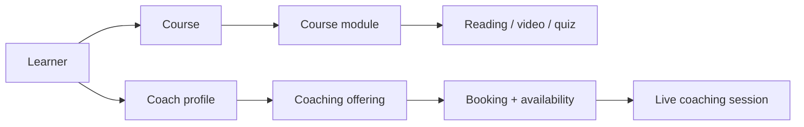

# Pemisahan pembelajaran dan coaching

Tanggal: 2026-11-17.

Status: user memilih MVP appointment 1-on-1 gratis (D19). Coaching independen
diimplementasikan dengan Profile, Slot dan Booking dalam domain JosjobLrn.Coaching.
Curriculum course di dokumen ini masih proposal. Group/paid coaching ditunda.
Detail perilaku MVP ada di docs/api/live-coaching.md.

## 1. Arah produk

Course menjadi pembelajaran terstruktur: modul berurutan berisi halaman baca,
video, dan quiz dalam satu course. Live Coaching menjadi layanan coach dengan
profil, ketersediaan dan booking yang mandiri dari course.

Seseorang dapat menjadi learner, penulis/pengajar course, dan coach sekaligus.
Menjadi pengajar course tidak otomatis membuat profil coach yang dipublikasikan.
Akses course dan hak masuk sesi coaching mempunyai entitlement masing-masing.

Jika fitur kelas live berbasis course tetap dipakai, tempatnya adalah sesi kelas
di dalam course/cohort. Naming dan navigasinya perlu membedakan fitur tersebut
dari pemesanan coach independen.

## 2. Baseline sebelum refactor

Temuan awal sebelum MVP coaching, berdasarkan source checkout `165ca0e9cd9a1b67f1566e29f11c73d13d26ddfb`
beserta perubahan working tree dari sesi ini:

| Bagian | Implementasi sebelum refactor | Target perubahan |
| --- | --- | --- |
| Course | Metadata, kategori, sharing, harga dan kelas | Tambah curriculum modul/lesson dan player |
| Enrollment | Resource `Enrollment` menghubungkan student ke `Class` | Course enrollment untuk akses/progress pembelajaran mandiri; enrollment kelas lama tetap dipertahankan saat transisi |
| Direktori coaching | `JosjobLrn.LiveCoaching` mengelompokkan instructor dari kelas di katalog | Baca profil coach yang sengaja dibuat dan dipublikasikan |
| Jadwal coaching | Diambil dari `Class.schedule` | Availability coach dan waktu booking |
| Akses panggilan | `Learning.live_role/2` memeriksa instructor/enrollment kelas | Admission berdasarkan coach dan peserta booking yang valid |
| Workspace pengajar | `main.dart` mengarahkan teacher ke workspace dokumen | Workspace coach khusus; pengguna dengan beberapa kemampuan tetap bisa mengakses learning |

Quiz backend saat ini masih scaffold. Adanya quiz UI dan integrasi media tidak
berarti curriculum, grading dan progress pelajaran sudah tersedia.

## 3. Resource yang diusulkan

### Pembelajaran

- `CourseModule`: course, judul dan urutan.
- `Lesson`: module, jenis reading/video/quiz, urutan, konten atau referensi media,
  status draft/published dan penanda required/preview.
- `CourseEnrollment`: learner, course, status dan versi curriculum yang dipakai.
- `LessonProgress`: course enrollment, lesson, posisi video dan status selesai.
- Quiz, pertanyaan, opsi, jawaban dan attempt di domain quiz. Grading dijalankan
  server; answer key tidak disertakan dalam response pertanyaan learner.

`Section` yang ada tetap kategori katalog. `CourseModule` adalah bab di dalam
course. Selesai coaching tidak otomatis menyelesaikan lesson atau course.

### Coaching

- `CoachProfile`: akun pemilik, nama publik, bio, keahlian, bahasa dan status
  publikasi/approval. Profil tidak dibuat otomatis dari role teacher.
- `CoachingOffering`: layanan yang ditawarkan coach, judul, deskripsi dan durasi.
  Kapasitas/group dan harga mengikuti keputusan produk yang masih terbuka.
- `CoachAvailability`: slot yang dapat dipesan, dengan timezone coach dan waktu
  konkret tersimpan sebagai timestamp UTC.
- `CoachingBooking`: offering, coach, learner, slot dan status booking.
- `CoachingSession`: sesi live terkait booking, dengan identitas room tersendiri.

Proposal awal adalah direktori profil coach publik yang telah disetujui.
Pengunjung yang login dapat memesan tanpa bergabung dengan organisasi atau
membeli course. Aturan untuk coach privat milik organisasi perlu keputusan
terpisah sebelum menambahkan visibilitas tersebut.

Status booking, aturan pembatalan/no-show, batas waktu masuk room, approval coach,
dan kepemilikan data organisasi perlu didefinisikan pada implementasi. Transaksi
dan constraint database harus mencegah booking ganda/overlap. Jika dipilih paid
coaching, harga dan status pembayaran diverifikasi server sebelum konfirmasi;
aturan expiry reservasi, refund dan pembatalan perlu ikut ditentukan.

## 4. Batas akses dan reuse infrastruktur

Tetap gunakan Phoenix/Ash umbrella, Repo bersama dan provider media yang ada.
Proposal pemilik resource: `josjob_lrn` untuk curriculum/progress,
`josjob_quiz` untuk assessment, dan domain `JosjobLrn.Coaching` untuk profil,
availability, booking dan admission coaching, terpisah dari domain Learning
dalam umbrella app yang sama. Tidak ada app atau microservice baru pada MVP.

`josjob_web` mengorkestrasi HTTP/channel; `josjob_ms` tetap provider media leaf.
Integrasi pembayaran yang ada dapat dipakai ulang jika paid coaching dipilih,
dengan produk/fulfillment terpisah dari enrollment course.

Rancangan room coaching: `coaching:<booking_id>`. Server harus mengecek booking,
status, identitas coach/peserta dan aturan waktu masuk pada setiap admission.
Coach mendapat host; peserta booking mendapat guest. Perubahan status seperti
pembatalan harus memengaruhi hak masuk, bukan sekadar menyembunyikan tombol UI.

**Mengganti prefix room saja tidak cukup.** `LiveRoomChannel.resolve_role/3`
saat ini menganggap room non-`class:` sebagai room bebas dan menerima role dari
payload klien. Namespace `coaching:` harus diproses oleh admission booking yang
ketat dan tidak boleh jatuh ke fallback room bebas, termasuk untuk ID invalid.
Test perlu mencakup booking orang lain, booking dibatalkan, ID invalid dan
pemalsuan host. Transport WebRTC dapat dipakai ulang setelah batas akses ini ada.

## 5. Alur UI target

Learner:

1. Courses: pilih course, enroll, baca/tonton/kerjakan quiz, lanjutkan progress.
2. Coaching: cari coach, lihat layanan dan slot, pesan, lihat booking, masuk sesi.

Coach: kelola profil, offering dan availability; lihat booking; jalankan sesi.
Course author: kelola curriculum dan materi. Kedua workspace tidak saling
memberikan izin secara otomatis.

Overview Learn mengambil progress course. Bagian coaching mengambil booking
mendatang. Profile coach tidak berisi rating atau histori sesi buatan; fitur
review hanya dapat ditambahkan dengan sumber data dan aturan yang nyata.

## 6. Urutan implementasi dan migrasi

1. Selesaikan pilihan format sesi dan pembayaran. Rekomendasi MVP: 1-on-1 gratis
   terlebih dahulu, tanpa menutup kemungkinan group/paid setelah alur utuh siap.
   User telah memilih 1-on-1 gratis pada D19. MVP memakai satu layanan per profil;
   Offering dan Session sebagai tabel tersendiri tetap rancangan pengembangan.
2. Tambah resource profil coach, offering, availability dan booking, termasuk
   permission, approval dan pencegahan bentrok slot.
3. Tambah admission coaching dan room berbasis booking, lalu ganti API/UI Live
   Coaching agar membaca context coaching.
4. Tambah curriculum/player dan enrollment/progress course untuk pembelajaran
   mandiri. Hubungkan dashboard ke data tersebut.
5. Migrasikan pemakai API lama secara eksplisit. Jangan mengubah course atau
   enrollment kelas yang ada menjadi coaching booking, dan jangan menghapus
   data lama. Pemetaan enrollment kelas ke enrollment course harus ditetapkan,
   idempoten dan diuji sebelum dijalankan.

Pemeriksaan penerimaan utama: learner tanpa course dapat memesan coach;
enrollment course tidak memberikan akses booking orang lain; coach hanya melihat
booking yang menjadi haknya; role teacher tidak otomatis menjadi coach;
progress course tetap benar setelah reload; dan data lama tetap dapat diakses
selama transisi.
