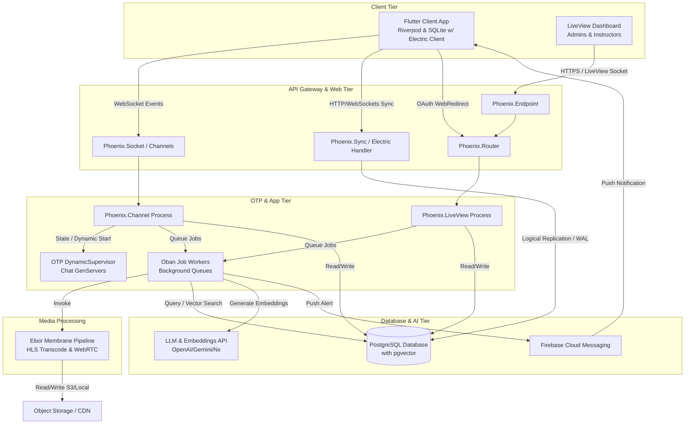
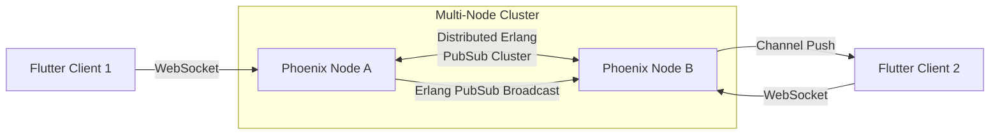
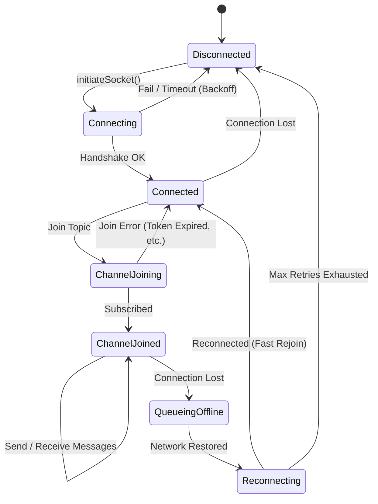
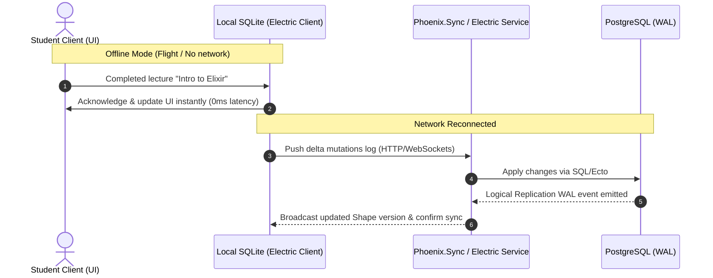

# System Architecture Overview

This document describes the high-level system design, topology, and technology choices for the Upskilling Course Platform.

---

## 1. System Topology & Data Flow

The platform is designed around a decoupled, real-time architecture where:
1. **Instructors and Admins** manage administrative operations, upload courses/materials, and configure the platform using a **Phoenix LiveView** web dashboard.
2. **Students, Instructors, and Teaching Assistants (TAs)** complete daily learning and engagement activities (consuming lectures, watching live streams, chatting, running AI tutoring sessions, taking quizzes, and holding 1-on-1 consultations) using a cross-platform **Flutter Client** (iOS, Android, and Web).
3. **Teaching Assistants (TAs)** can be assigned as **Co-Hosts** to help instructors moderate stream chats, launch polls, and trigger live quizzes.
4. **1-on-1 consultations** are supported, letting students book appointments with instructors and join private WebRTC media tunnels.
5. **Offline-First Database Synchronization** is powered by **ElectricSQL** (referred to as elasticsql) and **ash_sync**. The Flutter client reads and writes to a local SQLite database, allowing full offline usability. Database updates are synchronized in real-time with the Postgres backend via dynamic database "shapes" managed by ash_sync. Ephemeral, real-time events (like chat, live stream actions, and presence) utilize **Phoenix Channels** (WebSockets) as the primary bidirectional channel.
6. Medium-to-heavy computations, such as media processing, transcription, and vector embedding generation, are handled asynchronously via background workers managed by **Oban**.

### High-Level Topology

> [!NOTE]
> **Media tier — current implementation.** The "Media Processing / Membrane" tier
> above is the forward-looking design. Today, **Video-on-Demand is handled by
> managed Cloudflare Stream** in the dedicated **`apps/josjob_ms`** umbrella app
> (upload → transcode → HLS/CDN), not a self-hosted Membrane/S3 pipeline. Live
> WebRTC streaming via Membrane remains planned but unbuilt. See
> [`04_media_streaming.md`](./04_media_streaming.md) and
> [`enhancement/media_streaming_vod_integration.md`](./enhancement/media_streaming_vod_integration.md).

---

## 2. Technology Stack

### Backend Services (Phoenix / Elixir)
*   **Ash Framework (v3.x)**: Serves as the core business logic, resource modeling, and action engine.
*   **AshPostgres (`ash_postgres`)**: The database data layer mapping Ash Resources to PostgreSQL tables, supporting advanced operations like `pgvector` indexing.
*   **AshAuthentication (`ash_authentication` & `ash_authentication_phoenix`)**: Manages secure user registrations, logins, and session lifecycles including native Google OAuth2.
*   **ash_sync**: Integrates with ElectricSQL to sync subsets of the database ("shapes") to the clients in real time using logical replication from the Postgres WAL.
*   **ash_rbac**: Enforces declarative, role-based access control policies across all resources and actions.
*   **AshAdmin (`ash_admin`)**: Automatically generates a secure administrative web portal for data inspection and management tasks.
*   **Phoenix Framework (v1.8.x)**: Handles HTTP APIs, WebSocket connections (Channels), and LiveView dashboards.
*   **Phoenix LiveView**: Implements custom UI dashboards, enabling real-time file uploads (videos, slides, teaching materials) without complex client-side JS setups.
*   **ElectricSQL (referred to as elasticsql)**: The sync service that orchestrates real-time, local-first replication between PostgreSQL and client-side databases.
*   **Oban (w/ AshOban)**: Provides a robust, PostgreSQL-backed background job queue for heavy tasks like HLS transcoding, AI text extraction, vector database synchronization, and sending FCM notifications.
*   **Elixir Membrane Framework**: Coordinates media streams, WebRTC ingestion, and post-live HLS video-on-demand segmentation.
*   **Phoenix PubSub**: Native distributed message bus using pg2/pg clustering groups to broadcast messages across multiple server nodes.

### Frontend Application (Flutter)
*   **Flutter SDK**: Powers the cross-platform application (Android, iOS, Web).
*   **Riverpod**: State management library used to synchronize local state, handle WebSocket states, and coordinate API logic asynchronously.
*   **ElectricSQL Client SDK**: Integrates local database state (SQLite) with the server. It handles queries locally and manages delta-synchronization of database tables (e.g., course catalogs, enrollment status, progress states) in the background.
*   **phoenix_socket (Dart package)**: Establishes and manages the client-side Phoenix Channel connections, maintaining channels joins, heartbeats, and frame serializations.
*   **firebase_messaging**: Ingests background OS-level system push notifications.

---

## 3. Phoenix Channels Scaling Strategy

To handle tens of thousands of simultaneous connected students and real-time events (chat, quizzes, progress trackers), the Phoenix Channels layer leverages Elixir’s native clustering capabilities.

1.  **Distributed PubSub**: Phoenix PubSub operates out-of-the-box using Erlang's distributed networking (`pg` groups). When Client 1 on Node A sends a chat message to `course:chat:123`, the PubSub layer automatically replicates that message to Node B, which pushes it down to Client 2. No external Redis cluster is required for scaling pub/sub.
2.  **State Management Isolation**: For transient room states (e.g. who is typing, who is actively viewing, current quiz status), the application spawns local processes via a cluster-wide **DynamicSupervisor**. If a node crashes, the supervisor restarts the processes, fetching the last stored state from PostgreSQL.
3.  **Connection Multiplexing**: A single socket connection from the Flutter client handles multiple channels (`course:chat`, `user:notifications`, `user:progress`) simultaneously, minimizing socket handshake overhead and socket port exhaustion.

---

## 4. Flutter Socket Lifecycle Management

Flutter client socket management requires resilience against network handovers, app backgrounding, and flaky mobile connections. 

### Connection State Machine

### Resiliency Requirements

1.  **Adaptive Backoff Retry**: 
    If the socket connection is severed, the client executes an exponential backoff retry algorithm (e.g., retrying at $1s, 2s, 4s, 8s, 16s$, up to a maximum of $60s$ interval) to avoid flooding the backend servers.
2.  **Local-First Database Sync**:
    Critical student actions (such as completing a lecture checkpoint or submitting quiz answers) are written directly to the local SQLite database. The ElectricSQL client handles persistence, offline availability, and automatic background synchronization to the Postgres backend via `ash_sync` as soon as network connectivity is restored, resolving conflicts automatically using Last-Write-Wins (LWW) or CRDT rules.
3.  **Fast Rejoin Protocol**:
    Upon reconnection, the client sends a `rejoin` request with the last received event ID to allow the backend to stream back missed chat messages since the disconnection, avoiding complete database queries.
4.  **Riverpod Provider Structure**:
    A global `socketProvider` initializes the `PhoenixSocket` instance. Individual state notifier providers (e.g., `chatRoomProvider(courseId)`) depend on the socket provider and handle topic subscriptions (`PhoenixChannel`) independently.

---

## 5. Offline-First Synchronization Architecture (ash_sync & ElectricSQL)

To provide a seamless, local-first user experience that works offline and synchronizes instantly when online, the platform employs **ElectricSQL** (referred to as elasticsql) alongside **ash_sync**.

### Local-First Sync Flow

### Sync Strategy and Shape Replication

1.  **Shapes-Based Sync**: `ash_sync` exposes table subsets, called **Shapes**, to the Flutter client. For instance, the client only subscribes to the shape of `courses` relevant to their enrolled catalog, and `enrollment_progress` filtered by `user_id`. This prevents downloading the entire database and maintains strict security boundaries.
2.  **Zero-Latency Writes**: All user actions affecting synced state (e.g., marking a lecture as read, bookmarking, completing quizzes) write directly to the local SQLite database. The UI updates instantly without waiting for a network roundtrip.
3.  **Conflict Resolution**: Conflicts are resolved automatically at the ElectricSQL layer using Last-Write-Wins (LWW) CRDT registers.
4.  **Automatic Resync & Backfill**: When the device recovers from offline status, the Electric client performs a delta-sync, streaming only the missed transaction log since the last acknowledged shape version.
