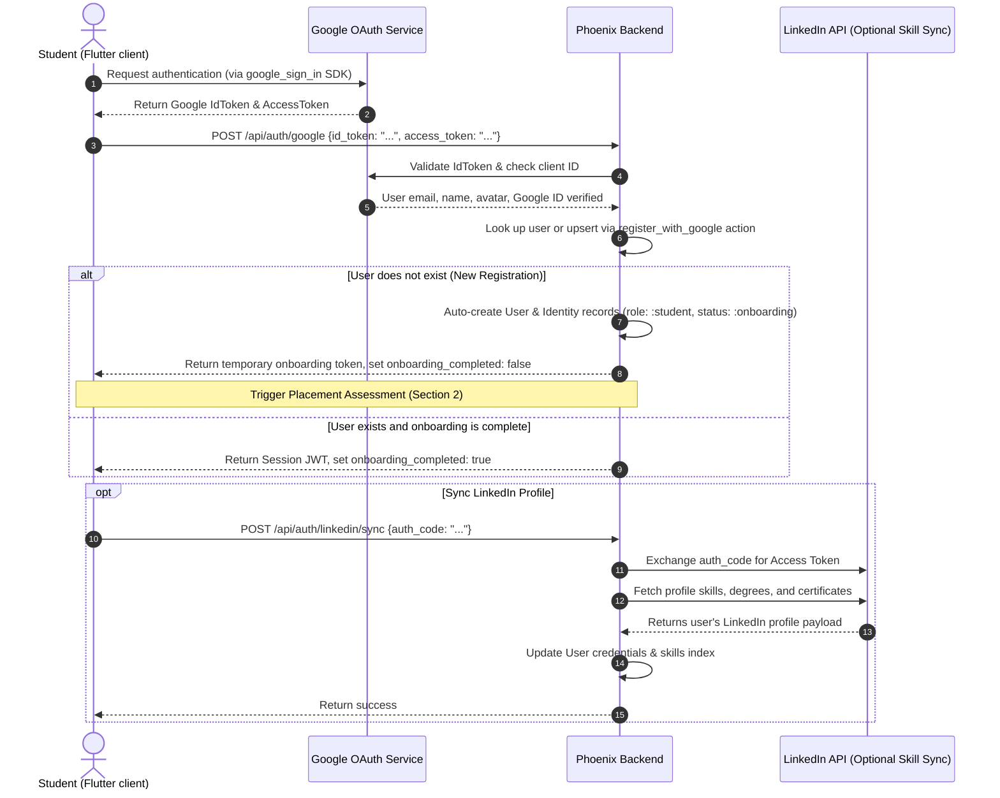
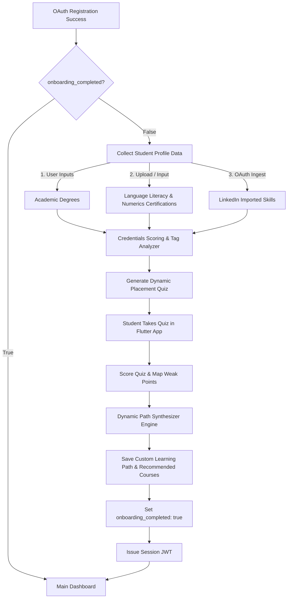

# Google OAuth Authentication & Channel Authorization

This document specifies the authentication flows, onboarding adaptive assessments, and real-time WebSocket connection security protocols. 

---

## 1. Google OAuth & Registration Flow

The platform utilizes Google OAuth 2.0 as the identity provider for authentication.

> [!IMPORTANT]
> When implementing the backend OAuth flow, the [ash_authentication](https://hex.pm/packages/ash_authentication) and [ash_authentication_phoenix](https://hex.pm/packages/ash_authentication_phoenix) libraries must be used, which natively handle the Google OAuth2 strategy and map authenticated identities to the `Stellar.Accounts.User` resource.
> Use ash_rbac as role based access control library and use below roles: 
  # "employer", "coordinator", "worker", "graduate", "superuser"
> Set initial roles for rbac in seed. 



### Backend Endpoint: `POST /api/auth/google`
*   **Payload Schema**:
    ```json
    {
      "id_token": "eyJhbGciOiJSUzI1...",
      "access_token": "ya29.a0AfH6SM..."
    }
    ```
*   **Response (New User - Onboarding required)**:
    ```json
    {
      "user": {
        "id": "123e4567-e89b-12d3-a456-426614174000",
        "email": "student@example.com",
        "name": "Jane Doe",
        "role": "student",
        "onboarding_completed": false
      },
      "onboarding_token": "onboard_jwt_token_here"
    }
    ```
*   **Response (Returning User - Onboarding complete)**:
    ```json
    {
      "user": {
        "id": "123e4567-e89b-12d3-a456-426614174000",
        "email": "student@example.com",
        "name": "Jane Doe",
        "role": "student",
        "onboarding_completed": true
      },
      "token": "session_jwt_token_here",
      "refresh_token": "refresh_token_here"
    }
    ```

---

## 2. Onboarding Placement Assessment Flow

To create a personalized curriculum, new students must undergo a placement assessment immediately after registration. This assessment evaluates academic credentials, literacy and numeracy certificates, LinkedIn skills, and an adaptive diagnostic quiz.

### Placement Pipeline Flow



### Details of Assessment Analysis

1.  **Credential Profiling**:
    *   **Academic Degrees**: Map degrees (e.g., Computer Science, Business, Arts) to specific skill matrices. A CS degree bypasses introductory logic topics, while a Business degree might adjust math/statistics baselines.
    *   **Literacy & Numerics Certifications**: Verify language certificates (e.g., IELTS, TOEFL) and numeric tests (e.g., GMAT quantitative scores). This sets the difficulty index for reading comprehension materials and technical coursework.
    *   **LinkedIn Skills Ingestion**: Parses standardized skill tags (e.g., "Python", "Project Management", "Data Structures"). Any matching skill receives a default baseline score, adapting quiz complexity.
2.  **Adaptive Placement Quiz**:
    *   The system generates a 15-question adaptive quiz covering core competencies.
    *   The backend retrieves questions dynamically: if the student answers a Python question correctly, the next question increases in difficulty; if they fail, the system drops back to fundamental logic.
    *   Quizzes are served via JSON API endpoints under `/api/onboarding/assessment`.
3.  **Weak Point Mapping & Learning Path Synthesis**:
    *   Each question is linked to a database `Topic` and `CourseSection`.
    *   Based on incorrect answers, the backend calculates a *Weakness Index* per topic.
    *   The system creates custom `StudentLearningPath` records, prioritizing course sections where the Weakness Index exceeds $60\%$, bypassing sections where the student demonstrated high proficiency.

---

## 3. WebSocket Channel Authorization

Once a student is authorized (`onboarding_completed: true` with a valid JWT), they establish a long-lived WebSocket connection to the Phoenix backend.

### Socket Connection Security (`UserSocket`)

The Flutter client passes the JWT as a query parameter during the socket handshake:
`ws://api.upskillplatform.com/socket/websocket?token=session_jwt_token_here`

```elixir
# lib/backend_web/channels/user_socket.ex
defmodule BackendWeb.UserSocket do
  use Phoenix.Socket
  require Logger

  channel "user:notifications:*", BackendWeb.NotificationChannel
  channel "user:progress:*", BackendWeb.ProgressChannel
  channel "course:chat:*", BackendWeb.ChatChannel
  channel "lecture:chat:*", BackendWeb.ChatChannel
  channel "quiz:live:*", BackendWeb.QuizChannel
  channel "user:ai_assistant:*", BackendWeb.AIAssistantChannel

  @impl true
  def connect(params, socket, _connect_info) do
    case Map.get(params, "token") do
      nil ->
        Logger.error("Socket connection rejected: missing token")
        :error

      token ->
        case AshAuthentication.Jwt.verify_token(token, Stellar.Accounts) do
          {:ok, %{"sub" => user_id}} ->
            case Ash.get(Stellar.Accounts.User, user_id) do
              {:ok, user} ->
                socket =
                  socket
                  |> Ash.Plug.Helpers.set_actor(user)
                  |> assign(:user_id, user.id)
                  |> assign(:user_role, user.role)

                {:ok, socket}

              _ ->
                Logger.error("Socket authentication failed: user not found")
                :error
            end

          {:error, reason} ->
            Logger.error("Socket authentication failed: #{inspect(reason)}")
            :error
        end
    end
  end

  @impl true
  def id(socket), do: "users_socket:#{socket.assigns.user_id}"
end
```

### Token Expiration and Refresh Protocol
1.  **JWT Expiration**: JWT sessions expire after 1 hour.
2.  **Graceful Disconnect / Refresh**:
    *   When the JWT is within 5 minutes of expiring, the Flutter client issues a REST request `POST /api/auth/refresh` using the stored secure `refresh_token`.
    *   The API returns a fresh JWT.
    *   The Flutter client updates its local state and tells the `PhoenixSocket` instance to update its connection parameters:
        ```dart
        // Flutter (Riverpod/PhoenixSocket client snippet)
        socket.updateToken(newJwtToken);
        ```
    *   If the token is not refreshed and expires, the channel process rejects messages and the socket is forcibly closed by the server. The client must then reconnect with a fresh token.
