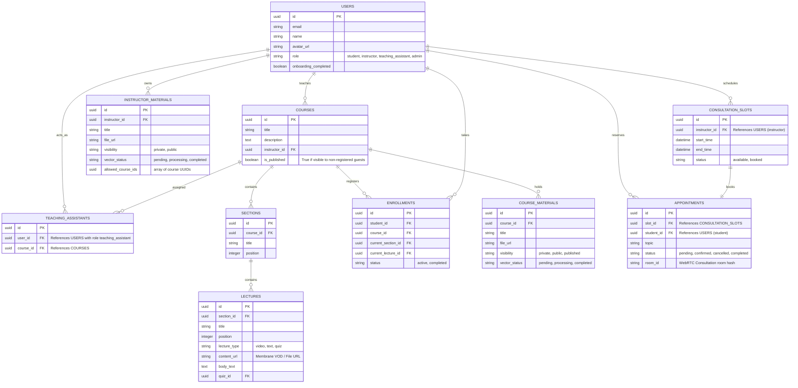
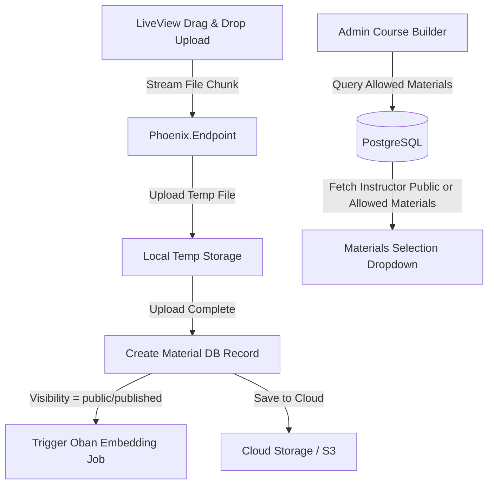

# Course, Content & Material Management

This document defines the schema designs, administrative dashboards (Phoenix LiveView), sharing permissions, and student interfaces (Flutter) for managing courses, lectures, slides, and educational materials.

---

## 1. Database Schema & Ash Resources

To support course creation, multi-tier materials sharing, and permissions, we structure the Ash Resources using `AshPostgres.DataLayer` as follows:



### Key Schema Configurations
*   **`visibility` tiers**:
    *   `private`: Material is accessible *only* to students enrolled in that specific course.
    *   `public`: Material is accessible to *all registered students* across the platform (searchable, indexable for general RAG Q&A).
    *   `published`: Material is accessible to *both registered students and anonymous public guests* (admins can configure this for marketing or open courses).
*   **`allowed_course_ids`**: An array of UUIDs indicating which courses are allowed to pull/reference a specific `InstructorMaterial`. If an instructor uploads a slide deck and marks it `private` but populates this array, those specified courses can attach it.
*   **`teaching_assistant` mapping**: Binds users with the role `:teaching_assistant` to specific courses, unlocking moderating and event-triggering privileges on the related channels.
*   **`room_id` in appointments**: Unique hash used to generate WebRTC consultation endpoints when the appointment starts.

---

## 2. LiveView Content Upload & Management Dashboard

Admins and Instructors use a real-time **Phoenix LiveView** application to edit courses, manage files, and track sharing constraints.



### Features of the LiveView Portal
1.  **Direct Upload Stream**:
    *   LiveView provides high-performance client-to-server chunked uploads for large video lectures or slide PDFs.
    *   Temp files are processed via a lifecycle pipeline: verified, uploaded to object storage (e.g. MinIO/S3), and indexed.
2.  **Granular Material Visibility Control**:
    *   When uploading, the LiveView component displays a visibility selector:
        *   **Instructors**: Select either `Private` (only for their active course lectures) or `Public` (share with all registered students on the platform).
        *   **Admins**: Can set `Private`, `Public`, or `Published` (making the material available on the open public web without auth).
3.  **Instructor Material Reuse Approval**:
    *   When Admins build a course outline, they can browse slides/documents uploaded by other instructors.
    *   The database query filter restricts options:
        ```elixir
        # Querying materials an admin can assign to a course using Ash
        # Under the hood, this uses an Ash custom read action (e.g. :assignable)
        # on the InstructorMaterial resource.
        def list_assignable_instructor_materials(course_id, instructor_id) do
          Stellar.Courses.InstructorMaterial
          |> Ash.Query.filter(
            instructor_id == ^instructor_id and
            (visibility == "public" or ^course_id in allowed_course_ids)
          )
          |> Ash.read!()
        end
        ```

### 4. One-on-One Consultation Scheduler Mechanism

To facilitate personalized mentoring, the platform implements a 1-on-1 appointment booking scheduler:

1.  **Instructor Availability Setup (LiveView)**:
    *   Instructors use a calendar grid interface in Phoenix LiveView to establish their consulting availability.
    *   Submitting availability bulk-inserts `ConsultationSlot` records with the status `"available"`.
2.  **Student Booking Lifecycle (Flutter)**:
    *   **Browsing**: Students view open slots via the Flutter app.
    *   **Reserving**: The student selects a slot, enters their discussion topic, and submits.
    *   **Concurrency Lock**: The booking transaction is run inside a database transaction to prevent double-booking:
        ```elixir
        # Booking slot and creating appointment using Ash actions
        def book_appointment(student_id, slot_id, topic) do
          # This operation runs in a transaction. We update the slot state and create the appointment.
          # Ash provides transactional actions or multi-resource changes via Ash.Changeset.
          Ash.run_transaction(Stellar.Courses, fn ->
            with {:ok, slot} <- Ash.get(Stellar.Courses.ConsultationSlot, slot_id),
                 true <- slot.status == "available",
                 {:ok, _updated_slot} <- Ash.update(slot, :book),
                 room_hash = :crypto.hash(:sha256, "#{slot_id}-#{student_id}") |> Base.encode16(),
                 {:ok, appointment} <- 
                   Stellar.Courses.Appointment
                   |> Ash.Changeset.for_create(:create, %{
                     slot_id: slot_id,
                     student_id: student_id,
                     topic: topic,
                     status: "confirmed",
                     room_id: room_hash
                   })
                   |> Ash.create() do
              appointment
            else
              false -> Ash.rollback(:slot_already_booked)
              {:error, reason} -> Ash.rollback(reason)
            end
          end)
        end
        ```

---

## 3. Flutter Operational Interface & API Endpoints

The Flutter application provides students with the frontend interface to navigate course catalogs, watch lectures, download materials, and view checkpoints.

### Flutter Course Navigation Layout
*   **Course Directory Screen**: Lists available courses. If a user is not logged in, they *only* see courses and materials marked as `published` (published items). If logged in, they see all registered courses plus platform-wide `public` contents.
*   **Lecture Viewer Screen**:
    *   **Video Panel**: Streams HLS videos with custom video checkpoints.
    *   **Materials Panel**: Lists related slide PDFs, slide texts, and handouts.
    *   **Discussion Panel**: WebSocket channel chat room.
    *   **Quiz Trigger**: Action button that unlocks once the video playback matches the lecture's quiz threshold.

### Key REST API endpoints (Flutter Support)

#### 1. Fetch Course Catalog (Guest / Authorized Student)
*   **Endpoint**: `GET /api/courses`
*   **Authorization**: Optional (Guest allowed).
*   **Behavior**: If the user is unauthenticated, the query returns only `published` courses and course materials. If authenticated, it returns available registered courses and `public` courses.
*   **Response**:
    ```json
    {
      "courses": [
        {
          "id": "c7a8b9c0-1234-5678-abcd-ef0123456789",
          "title": "Introduction to Python Programming",
          "description": "Learn the basics of coding with Python.",
          "instructor": "Dr. Sarah Jenkins",
          "is_published": true,
          "materials_count": 3
        }
      ]
    }
    ```

#### 2. Get Lecture Detail (Registered Student Only)
*   **Endpoint**: `GET /api/lectures/:id`
*   **Authorization**: Required (Bearer JWT).
*   **Behavior**: Verifies if the student is actively enrolled. Returns streaming metadata, transcripts, checkpoints, and material list.
*   **Response**:
    ```json
    {
      "lecture": {
        "id": "e8a9b0c1-5678-1234-abcd-ef0123456789",
        "title": "Control Flow and Loops",
        "lecture_type": "video",
        "content_url": "https://cdn.upskillplatform.com/hls/control_flow/playlist.m3u8",
        "checkpoints": [
          {"time_seconds": 45, "topic": "Introduction to If Statements"},
          {"time_seconds": 320, "topic": "Understanding While Loops"},
          {"time_seconds": 680, "topic": "Deep Dive: For Loops and Ranges"}
        ],
        "materials": [
          {
            "id": "m1122334-5678-1234-abcd-ef0123456789",
            "title": "Lecture Slides: Loops & Conditionals",
            "file_url": "https://cdn.upskillplatform.com/docs/loops_slides.pdf",
            "visibility": "private"
          }
        ]
      }
    }
    ```

---

## 4. RBAC (Role-Based Access Control) Enforcement matrix

Permissions are declaratively defined on the Ash Resources using the **ash_rbac** and `Ash.Policy.Authorizer` extensions. Policies automatically run checks before any action is executed, rather than relying on manual validation checks in controllers or channel joins.

| Resource | Guest (Unregistered) | Student (Registered) | Teaching Assistant (TA) | Instructor | Admin |
| :--- | :--- | :--- | :--- | :--- | :--- |
| **Published Course Catalog** | Read | Read | Read | Read | Read / Write |
| **Enrolled Lecture & Videos** | No Access | Read (if enrolled) | Read (if assigned course) | Read / Write (own) | Read / Write (all) |
| **Private Course Materials** | No Access | Read (if enrolled) | Read (if assigned course) | Read / Write (own) | Read / Write (all) |
| **Public Course Materials** | No Access | Read (all students) | Read (all students) | Read / Write (own) | Read / Write (all) |
| **Published Materials** | Read | Read | Read | Read / Write (own) | Read / Write (all) |
| **Instructor Upload Portal** | No Access | No Access | No Access | Read / Write (own) | Read / Write (all) |
| **Live Chat Moderation & Poll/Quiz Triggers** | No Access | Read / Answer | Read / Write (if assigned co-host) | Read / Write (own) | Read / Write (all) |
| **1-on-1 Consultations Setup**| No Access | No Access | No Access | Read / Write (own) | Read / Write (all) |
| **User Onboarding / DB Setup**| No Access | No Access | No Access | No Access | Read / Write (all) |
