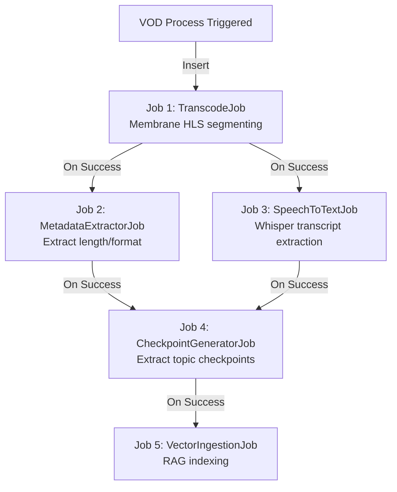
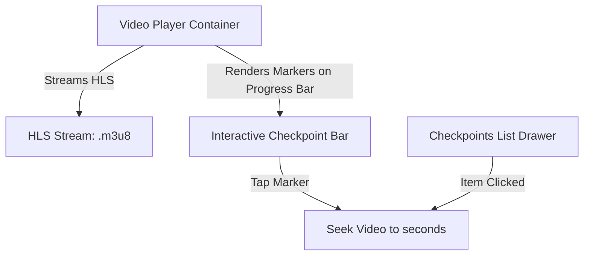

# Media Processing & Streaming Specification

This document specifies the real-time media ingestion, transcoding, post-live VOD compilation, audio transcription, automatic checkpointing, and video playback systems.

> [!IMPORTANT]
> **Implementation status & module location.** Media streaming lives in its own
> umbrella app, **`apps/josjob_ms`** (public API = the `JosjobMs` facade over
> `JosjobMs.CloudflareStream`). The **VOD** path described below (self-hosted
> Membrane HLS transcode + `ash_oban` job chain + S3/CloudFront + Whisper STT) is
> the original design and is **superseded** by a managed **Cloudflare Stream**
> integration — see [`enhancement/media_streaming_vod_integration.md`](./enhancement/media_streaming_vod_integration.md)
> and the HTTP contract in [`api/vod.md`](./api/vod.md). The **live** streaming
> design here (WebRTC SFU classroom, 1-on-1 consultation relay) and speech-to-text
> remain the forward-looking plan and are **not yet implemented**. New
> media/transcode/streaming-provider code belongs in `apps/josjob_ms`, behind the
> `JosjobMs` facade (see the backend module-map in `CLAUDE.md`).

---

## 1. Elixir Membrane Framework Integration

The platform handles real-time streams and audio/video processing via the **Elixir Membrane Framework**, which provides modular pipelines for ingestion, decoding, transcoding, and segmenting media.

### WebRTC Streaming Configurations

The media server supports two distinct WebRTC topologies depending on the lecture operational context:

1.  **Classroom Live Stream (SFU Mode)**:
    *   **Description**: A one-to-many broadcast. The instructor publishes their audio and video tracks to the Membrane WebRTC engine, which operates as a **Selective Forwarding Unit (SFU)**.
    *   **Behavior**: Membrane forwards the media packets to all enrolled students subscribed to the live class, adjusting bitrates dynamically using Simulcast.
2.  **1-on-1 Consultation Session (Peer-to-Peer Relay / TURN)**:
    *   **Description**: A private, bidirectional channel.
    *   **Behavior**: When a booked `Appointment` begins, both the student and instructor establish connections. Membrane acts as a Signaling and STUN/TURN server, attempting to negotiate a direct peer-to-peer (P2P) WebRTC connection between their Flutter apps. If direct connection fails due to strict NATs, Membrane relays the media packets in a secure, isolated tunnel, bypassing the recording and transcription pipelines.

### Media Streaming Topology

```mermaid
graph TD
    %% Streaming Phase
    subgraph Classroom Broadcast (SFU)
        Instructor[Instructor WebRTC Client] -->|Publish RTC| MembraneSFU[Membrane WebRTC SFU Engine]
        MembraneSFU -->|Record FLV/MP4| MembraneRecorder[Membrane File Recorder]
        MembraneSFU -->|Simulcast Broadcast| Students[Students WebRTC Client]
    end

    subgraph 1-on-1 Consultation (P2P Relay)
        StudentConsult[Student App] <-->|Bidirectional WebRTC Session| P2PRelay[Membrane P2P / TURN Relay]
        P2PRelay <-->|Bidirectional WebRTC Session| InstructorConsult[Instructor App]
    end
    
    %% Recording Phase
    MembraneRecorder -->|Save raw container| Storage[(Local Temp Storage)]

    %% Processing Phase
    Storage -->|Stream Complete Event| ObanQueue[Oban Job queue]
    ObanQueue -->|TranscodeJob| MembraneHLS[Membrane HLS Segmenter Pipeline]
    MembraneHLS -->|Output HLS .m3u8 & .ts chunks| S3[(S3 VOD Storage & CloudFront)]
```

### Live-to-VOD Transcoding Pipeline
When a live stream concludes, the Membrane recorder closes the container file. An event triggers an **Oban** job that runs the following Membrane HLS segmenter pipeline:

```elixir
defmodule Backend.Media.HLSPipeline do
  use Membrane.Pipeline

  @impl true
  def handle_init(_ctx, options) do
    structure = [
      # Read the raw recorded file
      child(:source, %Membrane.File.Source{location: options.input_path})
      # Parse container
      |> child(:demuxer, Membrane.MP4.Demuxer.ISOM)
      
      # Audio path
      |> via_out(:audio)
      |> child(:audio_parser, Membrane.AAC.Parser)
      |> child(:audio_decoder, Membrane.AAC.FDK.Decoder)
      |> child(:audio_encoder, Membrane.AAC.FDK.Encoder)
      
      # Video path
      # Link demuxer video output
      # Demuxer outputs video directly
    ]
    
    # In practice, we set up video and audio tracks, link them to an HLS.Sink,
    # which writes individual .ts files and an index.m3u8 file to S3.
    {:ok, %{spec: structure}, %{}}
  end
end
```

---

## 2. Oban Background Job Coordination (via `ash_oban`)

All post-live media processing operations are structured as sequential, resilient background jobs managed by **Oban** and triggered via **ash_oban** on resource action transitions (e.g., when a lecture state becomes `:transcoding`). Using Oban ensures that failures during transcoding or AI transcription are retried with exponential backoff and do not affect the main server processes.

### Processing Pipeline & Dependencies



### Oban Workers Specs

#### 1. `Backend.Workers.TranscodeJob`
*   **Queue**: `media_processing`
*   **Action**: Instantiates the `Membrane.Pipeline` to convert raw recordings into HLS streams ($720p, 1080p$ multi-bitrate streams with segment size of 4 seconds).
*   **Result**: Outputs HLS artifacts to AWS S3.

#### 2. `Backend.Workers.SpeechToTextJob`
*   **Queue**: `ai_transcription`
*   **Action**: Extracts the audio stream from the source file (converts to Mono 16kHz WAV format). Submits the audio payload to the AI Transcription Engine (e.g. OpenAI Whisper API, AWS Transcribe, or a local Bumblebee/Nx process running Whisper).
*   **Result**: Stores a structured transcript with paragraph-level timestamps.
    ```json
    [
      {"start_seconds": 12.5, "end_seconds": 25.0, "text": "Welcome to our class on data structures."},
      {"start_seconds": 45.1, "end_seconds": 92.4, "text": "Today we are analyzing loops, and how loops can cause computational bottlenecks."}
    ]
    ```

#### 3. `Backend.Workers.CheckpointGeneratorJob`
*   **Queue**: `ai_transcription`
*   **Action**: Runs an LLM script analyzing the transcript text blocks alongside the timestamps. It detects shifts in subject matter (e.g., transition from "If statements" to "While loops") and generates logical topic checkpoints.
*   **Result**: Saves records into the `Josjob.Courses.VideoCheckpoint` Ash Resource.

---

## 3. Flutter HLS Video Player Integration

The Flutter app leverages HLS VOD feeds to offer students adaptive, interactive video playback that utilizes the auto-generated checkpoints.

### Timeline Checkpoints Integration

*   **HLS Video Player**: Uses `better_player` or `video_player` with HLS configuration.
*   **Visual Indicators**: Checkpoint segments are displayed as markers along the player’s seek-bar timeline.
*   **Topic Drawer**: A collapsible panel beside the video displays a table of contents showing the topics and start times.



### Flutter Code Architecture (Riverpod / Player Control)
The client fetches lecture metadata and initial video seek parameters using Riverpod providers:

```dart
// Riverpod provider for active lecture
final lectureDetailProvider = FutureProvider.family<Lecture, String>((ref, lectureId) async {
  final api = ref.read(apiClientProvider);
  return api.fetchLecture(lectureId);
});

// BetterPlayer controller state notifier
class PlayerStateNotifier extends StateNotifier<BetterPlayerController?> {
  PlayerStateNotifier() : super(null);

  void initialize(String videoUrl) {
    BetterPlayerConfiguration configuration = BetterPlayerConfiguration(
      aspectRatio: 16 / 9,
      fit: BoxFit.contain,
      autoPlay: true,
      handleLifecycle: true,
    );
    BetterPlayerDataSource dataSource = BetterPlayerDataSource(
      BetterPlayerDataSourceType.network,
      videoUrl,
      liveStream: false,
    );
    state = BetterPlayerController(configuration)..setupDataSource(dataSource);
  }

  void seekToTopic(int seconds) {
    state?.seekTo(Duration(seconds: seconds));
  }
}
```
