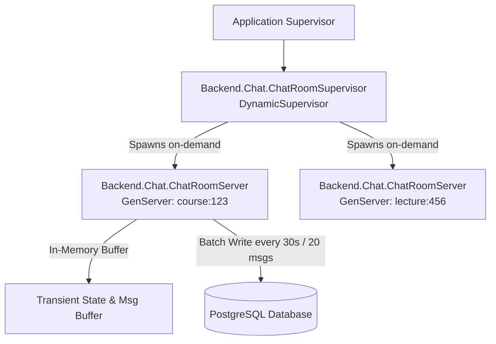
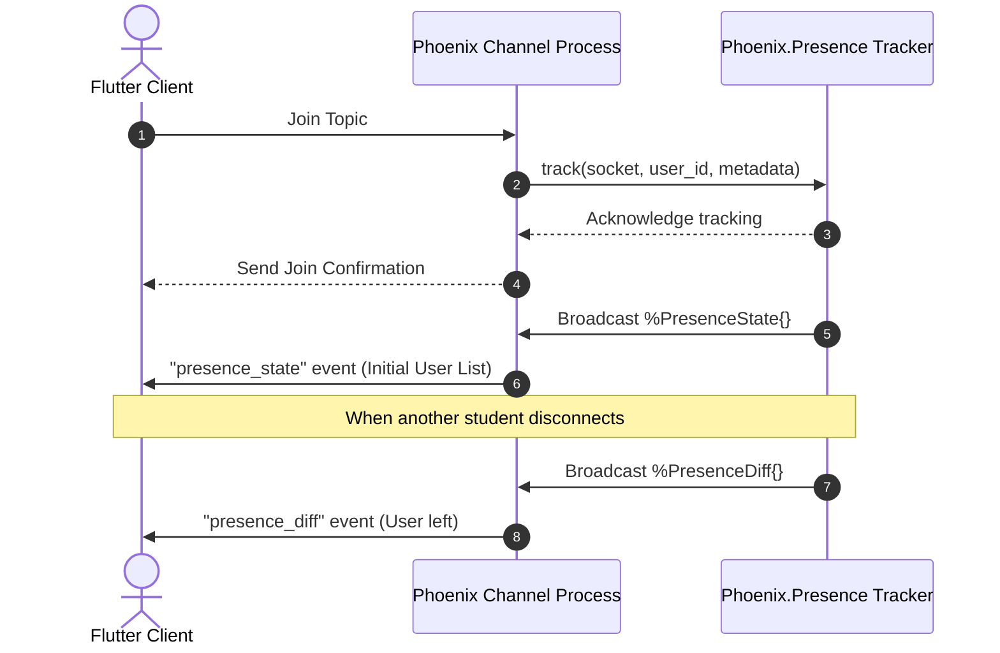

# Real-time Collaboration & Discussion Chat

This document details the real-time chat architecture, Phoenix Channel setup, OTP supervision trees for server-side state, message persistence buffers, and Riverpod frontend bindings.

---

## 1. OTP Supervision & Stateful Chat Processes

To prevent database bottleneck operations and maintain dynamic features like active viewer counts, the system utilizes a stateful OTP design. Each active course or lecture room chat operates its own dedicated `GenServer` worker process spawned dynamically by a `DynamicSupervisor`.

### OTP Supervisor Hierarchy



### Server Process Logic: `ChatRoomServer`
1.  **On-Demand Initialization**:
    When a student attempts to join a channel (e.g. `course:chat:123`), the `join/3` callback checks if a process named `ChatRoomServer:course:123` is running. If not, it calls the `DynamicSupervisor` to spin it up.
2.  **State Management**:
    The GenServer stores:
    *   `message_buffer`: A list of recent messages.
    *   `active_members`: A map of user IDs and their socket metadata.
    *   `typing_users`: A map of user IDs actively typing.
3.  **Write-Back Buffer**:
    Instead of writing every single sent message immediately to PostgreSQL via Ecto (which causes high I/O wait times under heavy usage), the GenServer caches messages.
    *   **Flush Triggers**: A write to the database occurs when **either** 30 seconds have passed since the last flush, **or** the buffer reaches 20 unpersisted messages.
    *   **Graceful Shutdown**: Upon termination, the GenServer's `terminate/2` callback executes a synchronous write-back to prevent message loss.

```elixir
# lib/backend/chat/chat_room_server.ex
defmodule Backend.Chat.ChatRoomServer do
  use GenServer, restart: :transient
  alias Stellar.Chat.Message

  # Client API
  def start_link(room_id) do
    GenServer.start_link(__MODULE__, room_id, name: via_tuple(room_id))
  end

  def add_message(room_id, msg_payload) do
    GenServer.call(via_tuple(room_id), {:add_message, msg_payload})
  end

  # Server Callbacks
  @impl true
  def init(room_id) do
    schedule_flush()
    {:ok, %{room_id: room_id, buffer: [], last_flush: DateTime.utc_now()}}
  end

  @impl true
  def handle_call({:add_message, msg}, _from, state) do
    new_buffer = [msg | state.buffer]
    state = %{state | buffer: new_buffer}
    
    if length(new_buffer) >= 20 do
      {:reply, :ok, flush_messages(state)}
    else
      {:reply, :ok, state}
    end
  end

  @impl true
  def handle_info(:flush, state) do
    schedule_flush()
    {:noreply, flush_messages(state)}
  end

  # Helpers
  defp via_tuple(room_id), do: {:global, {:chat_room_server, room_id}}
  defp schedule_flush(), do: Process.send_after(self(), :flush, 30_000)

  defp flush_messages(%{buffer: []} = state), do: state
  defp flush_messages(state) do
    # Batch write messages via Ash bulk create action
    # state.buffer is a list of maps containing message fields
    Ash.bulk_create(state.buffer, Message, :create)
    %{state | buffer: [], last_flush: DateTime.utc_now()}
  end
end
```

---

## 2. Channel Design & Event Payloads

### Channel Routes
*   `course:chat:<course_id>`: For course-wide discussion.
*   `lecture:chat:<lecture_id>`: Context-specific discussion relative to video timestamps.

### Connection Validation
Upon channel subscription:
*   The system reads the socket's actor/user representation.
*   It queries the `Stellar.Courses.Enrollment` resource to confirm if the user has an active enrollment in the parent course. If unauthorized, returns `{:error, %{reason: "unauthorized"}}`.

### Communication Event Schemas

#### 1. Join Channel (`join`)
*   **Topic**: `course:chat:c7a8b9c0-1234-5678-abcd-ef0123456789`
*   **Client Request**: `phx_join` payload is empty (JWT is verified during connection).
*   **Server Response**:
    ```json
    {
      "status": "ok",
      "history": [
        {
          "message_id": "m1111111-2222-3333-4444-555555555555",
          "user_name": "Jane Doe",
          "body": "Hello class! Excited to get started.",
          "timestamp": "2026-06-24T10:00:00Z"
        }
      ]
    }
    ```

#### 2. Sending Messages (`new_msg`)
*   **Client Event**: `new_msg`
*   **Client Payload**:
    ```json
    {
      "body": "Does anyone know when assignment 1 is due?"
    }
    ```
*   **Server Event Broadcast**: `shout_msg`
*   **Server Broadcast Payload**:
    ```json
    {
      "message_id": "m2222222-3333-4444-5555-666666666666",
      "user_id": "123e4567-e89b-12d3-a456-426614174000",
      "user_name": "Jane Doe",
      "body": "Does anyone know when assignment 1 is due?",
      "timestamp": "2026-06-24T11:22:00Z"
    }
    ```

#### 3. Typing Indicator (`typing`)
*   **Client Event**: `typing`
*   **Payload**: `{"is_typing": true}` or `{"is_typing": false}`
*   **Server Broadcast**: `user_typing`
*   **Broadcast Payload**: `{"user_id": "...", "user_name": "Jane Doe", "is_typing": true}`

#### 4. Co-Host Moderation Actions (Instructors / TAs Only)
Only users with role `instructor`, `admin`, or assigned `teaching_assistant` designated as co-host can trigger these actions:

*   **Delete Message (`delete_msg`)**:
    *   *Client Event*: `delete_msg`
    *   *Payload*: `{"message_id": "m2222222-3333-4444-5555-666666666666"}`
    *   *Server Broadcast*: `msg_deleted`
    *   *Broadcast Payload*: `{"message_id": "m2222222-3333-4444-5555-666666666666", "deleted_by": "TA John"}`
*   **Mute Student (`mute_student`)**:
    *   *Client Event*: `mute_student`
    *   *Payload*: `{"student_id": "123e4567-e89b-12d3-a456-426614174000", "duration_minutes": 10}`
    *   *Server Action*: Restricts the student's socket from publishing to the chat room.
    *   *Server Broadcast*: `student_muted`
    *   *Broadcast Payload*: `{"student_id": "123e4567-e89b-12d3-a456-426614174000", "muted_by": "TA John", "until": "2026-06-24T11:40:00Z"}`

#### 5. Co-Host Trigger Actions (Instructors / TAs Only)
*   **Trigger Live Quiz (`trigger_live_quiz`)**:
    *   *Client Event*: `trigger_live_quiz`
    *   *Payload*: `{"quiz_id": "q999-aaa"}`
    *   *Server Action*: Connects to the Quiz state machine (see `docs/07_quizzes_assessments.md`) and begins broadcasting question tracks.
*   **Trigger Live Poll (`trigger_live_poll`)**:
    *   *Client Event*: `trigger_live_poll`
    *   *Payload*:
        ```json
        {
          "poll_question": "Which programming language do you use most?",
          "options": ["Python", "Dart/Flutter", "Elixir", "JavaScript"],
          "duration_seconds": 60
        }
        ```
    *   *Server Broadcast*: `poll_started`
    *   *Broadcast Payload*:
        ```json
        {
          "poll_id": "p111-222",
          "poll_question": "Which programming language do you use most?",
          "options": ["Python", "Dart/Flutter", "Elixir", "JavaScript"],
          "ends_at": "2026-06-24T11:31:00Z"
        }
        ```

---

## 3. Presence Tracking Architecture

We use **Phoenix.Presence** to track active students within a chat room without querying the database for list states.



*   **State payload**:
    ```json
    {
      "presence_state": {
        "user_id_123": {
          "metas": [{"phx_ref": "F8j2h9s", "online_at": "2026-06-24T11:00:00Z", "device": "mobile"}]
        }
      }
    }
    ```

---

## 4. Flutter Integration (Riverpod)

The Flutter client structures real-time communication by injecting channel subscriptions into Riverpod state streams.

```dart
// State model for chat messages
class ChatState {
  final List<Message> messages;
  final Set<String> typingUsers;
  final bool isConnected;

  ChatState({required this.messages, required this.typingUsers, this.isConnected = false});
}

// StateNotifier providing chat room messaging updates
class ChatRoomNotifier extends StateNotifier<ChatState> {
  final PhoenixSocket _socket;
  final String _courseId;
  PhoenixChannel? _channel;

  ChatRoomNotifier(this._socket, this._courseId) : super(ChatState(messages: [], typingUsers: {})) {
    _joinChannel();
  }

  void _joinChannel() {
    _channel = _socket.addChannel(topic: "course:chat:$_courseId");
    
    _channel?.join().receive("ok", (response) {
      final history = (response["history"] as List).map((m) => Message.fromJson(m)).toList();
      state = ChatState(messages: history, typingUsers: {}, isConnected: true);
    });

    _channel?.on("shout_msg", (payload, ref) {
      final newMsg = Message.fromJson(payload);
      state = ChatState(
        messages: [...state.messages, newMsg],
        typingUsers: state.typingUsers,
        isConnected: true
      );
    });

    _channel?.on("user_typing", (payload, ref) {
      final name = payload["user_name"] as String;
      final isTyping = payload["is_typing"] as bool;
      final newTyping = Set<String>.from(state.typingUsers);
      
      if (isTyping) {
        newTyping.add(name);
      } else {
        newTyping.remove(name);
      }
      
      state = ChatState(messages: state.messages, typingUsers: newTyping, isConnected: true);
    });
  }

  void sendMessage(String text) {
    _channel?.push(event: "new_msg", payload: {"body": text});
  }

  void setTypingStatus(bool isTyping) {
    _channel?.push(event: "typing", payload: {"is_typing": isTyping});
  }

  @override
  void dispose() {
    _channel?.leave();
    super.dispose();
  }
}
```
