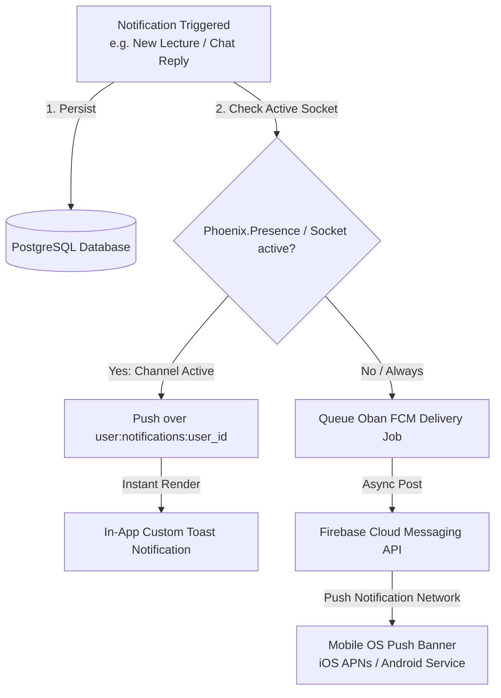
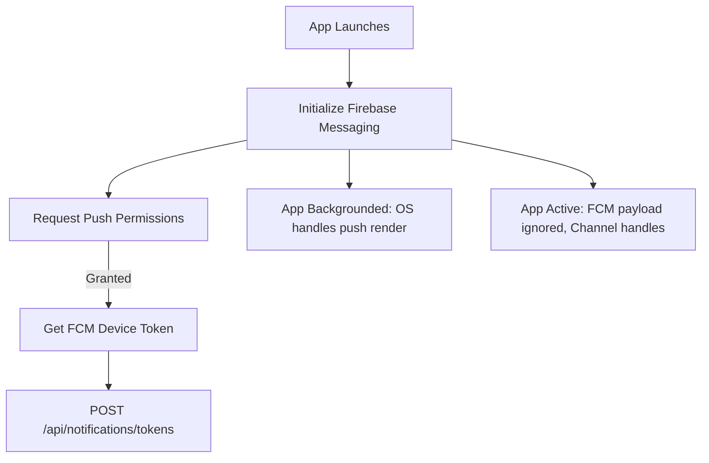

# Real-time Global Notifications System

This document specifies the hybrid notification delivery system, detailing database schemas, in-app WebSocket broadcasts, background Firebase Cloud Messaging (FCM) configurations, and synchronization protocols.

---

## 1. Hybrid Notification Delivery Model

To ensure reliable delivery, notifications use a dual-path mechanism:
*   **Active Session (In-App)**: Delivered instantly over a dedicated Phoenix Channel (`user:notifications:<user_id>`) for active students.
*   **Inactive Session (Background/Closed)**: Dispatched asynchronously via Firebase Cloud Messaging (FCM) using an **Oban** background worker queue.

### Dual-Path Delivery Flow



---

## 2. Database Schema & Ash Resources

Notifications must track delivery state, user device tokens, and unread badges using the following Ash Resources:

```elixir
# Notification Resource
defmodule Stellar.Notifications.Notification do
  use Ash.Resource,
    otp_app: :stellar,
    data_layer: AshPostgres.DataLayer

  postgres do
    table "notifications"
    repo Stellar.Repo
  end

  attributes do
    uuid_primary_key :id
    attribute :title, :string, allow_nil?: false
    attribute :body, :string, allow_nil?: false
    attribute :action_url, :string
    attribute :is_read, :boolean, default: false, allow_nil?: false
  end

  relationships do
    belongs_to :user, Stellar.Accounts.User
  end

  actions do
    defaults [:read, :destroy]
    create :create
    update :mark_read do
      change set_attribute(:is_read, true)
    end
  end
end

# FCM Token Resource
defmodule Stellar.Notifications.FCMToken do
  use Ash.Resource,
    otp_app: :stellar,
    data_layer: AshPostgres.DataLayer

  postgres do
    table "fcm_tokens"
    repo Stellar.Repo
  end

  attributes do
    uuid_primary_key :id
    attribute :token, :string, allow_nil?: false
    attribute :platform, :string, allow_nil?: false
  end

  relationships do
    belongs_to :user, Stellar.Accounts.User
  end

  actions do
    defaults [:read, :destroy]
    create :create
  end
end
```

---

## 3. Phoenix Channel: `user:notifications:<user_id>`

### Connection Validation
The channel path maps strictly to the logged-in student’s ID: `user:notifications:123e4567-e89b-12d3-a456-426614174000`.
*   The `join/3` callback compares the topic's `user_id` parameter against the socket’s `:user_id` assign. If they mismatch, the join is rejected.

### Channel Event Structure

#### 1. In-App Notification Delivery (`notify`)
When a new notification is created, the backend pushes this payload:
*   **Topic**: `user:notifications:123e4567-e89b-12d3-a456-426614174000`
*   **Event**: `notify`
*   **Payload**:
    ```json
    {
      "id": "n8888888-9999-0000-aaaa-bbbbbbbbbbbb",
      "title": "New Lecture Uploaded",
      "body": "Dr. Sarah Jenkins uploaded 'Loops and Ranges' to Python Course.",
      "action_url": "stdcourse://app/courses/c7a8b9c0/lecture/e8a9b0c1",
      "inserted_at": "2026-06-24T11:30:00Z"
    }
    ```

#### 2. Marking Notification Read (`read`)
The Flutter client sends this event to the server when the user opens or taps a notification:
*   **Event**: `mark_read`
*   **Payload**: `{"notification_id": "n8888888-9999-0000-aaaa-bbbbbbbbbbbb"}`
*   **Server Behavior**: Updates `is_read` to `true` in PostgreSQL and acknowledges with `{:reply, :ok, socket}`.

---

## 4. Firebase Cloud Messaging (FCM) Integration

To alert users whose devices are offline or when the app is in the background, we invoke an **Oban** background worker to call the FCM v1 HTTP API.

### Oban FCM Delivery Worker

```elixir
defmodule Stellar.Workers.SendPushNotificationJob do
  use Oban.Worker, queue: :push_notifications, max_attempts: 3

  @impl true
  def perform(%Oban.Job{args: %{"notification_id" => notif_id}}) do
    # Fetch the notification and load the user and their associated fcm_tokens using Ash
    case Stellar.Notifications.Notification
         |> Ash.Query.filter(id == ^notif_id)
         |> Ash.Query.load(user: :fcm_tokens)
         |> Ash.read_one() do
      {:ok, %{user: %{fcm_tokens: fcm_tokens}} = notif} ->
        tokens = Enum.map(fcm_tokens, & &1.token)
        
        if Enum.any?(tokens) do
          payload = build_fcm_payload(notif, tokens)
          case send_to_fcm(payload) do
            {:ok, _response} -> :ok
            {:error, reason} -> {:error, reason}
          end
        else
          :ok # No registered devices, exit gracefully
        end

      _ ->
        {:error, :notification_not_found}
    end
  end

  defp build_fcm_payload(notif, tokens) do
    # Formulate FCM v1 JSON payload
    %{
      "message" => %{
        "notification" => %{
          "title" => notif.title,
          "body" => notif.body
        },
        "data" => %{
          "click_action" => "FLUTTER_NOTIFICATION_CLICK",
          "action_url" => notif.action_url
        },
        "tokens" => tokens
      }
    }
  end

  defp send_to_fcm(payload) do
    # Uses Req client with Google OAuth service account credentials
    Req.post("https://fcm.googleapis.com/v1/projects/std-course/messages:send", 
      json: payload,
      auth: {:bearer, get_service_account_token()}
    )
  end
end
```

---

## 5. Flutter FCM & Channel Management (Riverpod)

The Flutter application requires coordination between the Firebase Messaging client and the Phoenix channel connection.



### Riverpod Notifications Orchestration

```dart
final notificationStateProvider = StateNotifierProvider<NotificationNotifier, List<AppNotification>>((ref) {
  final socket = ref.watch(socketProvider);
  return NotificationNotifier(socket);
});

class NotificationNotifier extends StateNotifier<List<AppNotification>> {
  final PhoenixSocket _socket;
  PhoenixChannel? _channel;

  NotificationNotifier(this._socket) : super([]) {
    _joinNotificationChannel();
    _setupFirebaseMessaging();
  }

  void _joinNotificationChannel() {
    _channel = _socket.addChannel(topic: "user:notifications:${_socket.userId}");
    
    _channel?.join().receive("ok", (response) {
      // Load unread history
      final unread = (response["unread"] as List).map((n) => AppNotification.fromJson(n)).toList();
      state = unread;
    });

    _channel?.on("notify", (payload, ref) {
      final newNotif = AppNotification.fromJson(payload);
      state = [newNotif, ...state];
      // Display native local in-app alert/banner
    });
  }

  void _setupFirebaseMessaging() async {
    FirebaseMessaging messaging = FirebaseMessaging.instance;
    
    // Ingest FCM device token and register with API
    String? token = await messaging.getToken();
    if (token != null) {
      await registerTokenWithBackend(token);
    }

    // Listener for foreground notifications (ignore, as WebSocket channel handles it)
    FirebaseMessaging.onMessage.listen((RemoteMessage message) {
      // Channel processes the message. Ignore FCM push to prevent duplicate popups.
    });

    // Ingest notification click/interaction when app opens from background
    FirebaseMessaging.onMessageOpenedApp.listen((RemoteMessage message) {
      final actionUrl = message.data["action_url"] as String?;
      if (actionUrl != null) {
        // Route application navigator to deep link target
      }
    });
  }

  Future<void> registerTokenWithBackend(String token) async {
    // Send POST request `/api/notifications/tokens` with FCM token
  }

  void markNotificationAsRead(String id) {
    _channel?.push(event: "mark_read", payload: {"notification_id": id});
    state = state.where((n) => n.id != id).toList();
  }
}
```
