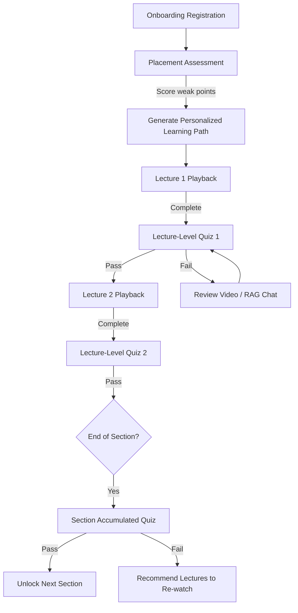
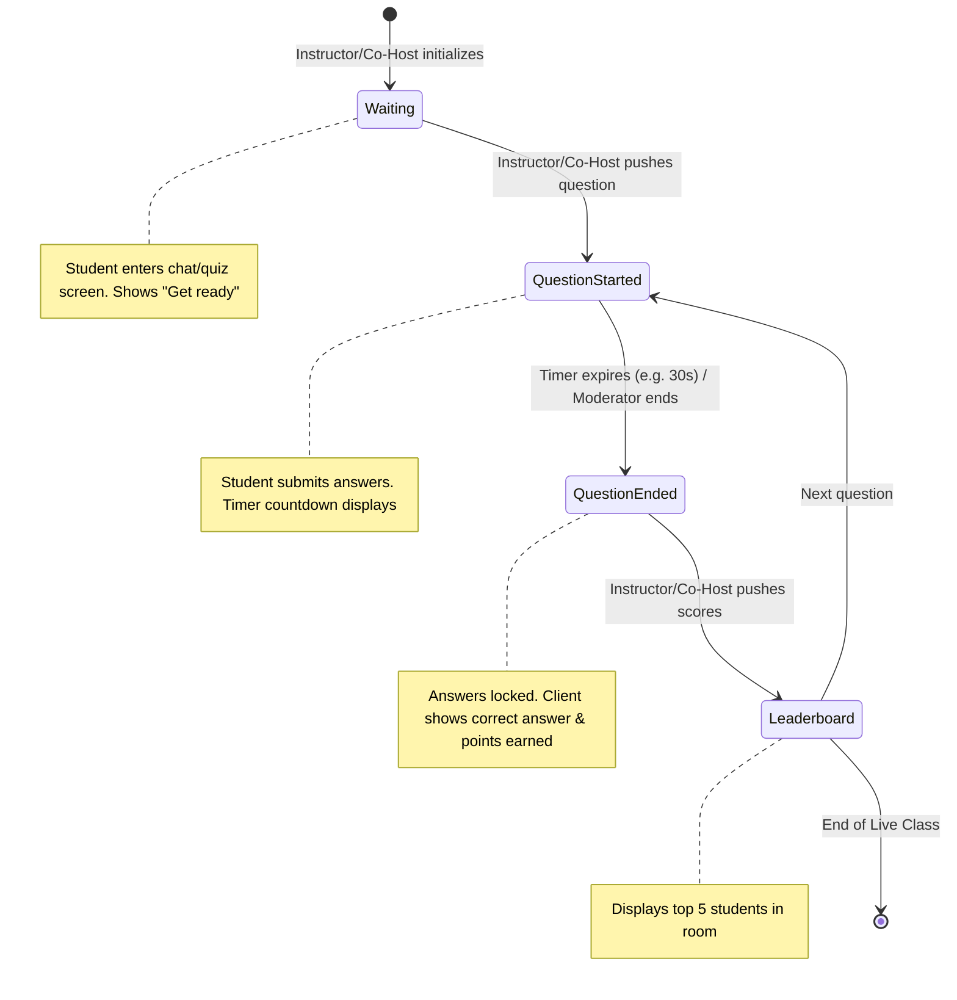

# Assessments & Quizzes System

This document specifies the multi-tier assessment models, database structures, the state machine for live classroom quizzes, and client-side visualization.

---

## 1. Multi-tier Assessment Architecture

To measure and guide student progress, the platform executes three distinct assessment models:

| Assessment Tier | Timing | Target Content | Goal | Progression Impact |
| :--- | :--- | :--- | :--- | :--- |
| **Placement Assessment** | During Registration | Broad Course Catalog Topics | Map baseline skills and identify weak points. | Generates the custom `StudentLearningPath`. |
| **Lecture-level Assessment** | After Every Lecture | Specific lecture video/text content | Verify immediate comprehension. | Must pass (e.g. $\ge 70\%$) to unlock the next lecture. |
| **Section-level Assessment** | After Every Course Section | Cumulative section material | Verify retention of the combined lectures. | Must pass (e.g. $\ge 75\%$) to unlock the next section. |
| **Live Classroom Quiz** | During WebRTC Live Class | Active slide topic | Real-time interaction & gamified learning. | Provides extra credit and boosts dynamic leaderboard. |



---

## 2. Database Models (Ash Resources)

```elixir
# Quiz Resource
defmodule Stellar.Assessments.Quiz do
  use Ash.Resource,
    otp_app: :stellar,
    data_layer: AshPostgres.DataLayer

  postgres do
    table "quizzes"
    repo Stellar.Repo
  end

  attributes do
    uuid_primary_key :id
    attribute :title, :string, allow_nil?: false
    attribute :quiz_type, :string, allow_nil?: false # "placement", "lecture", "section", "live"
  end

  relationships do
    belongs_to :course, Stellar.Courses.Course
    belongs_to :lecture, Stellar.Courses.Lecture # Optional, only for lecture-level
    has_many :questions, Stellar.Assessments.Question
  end

  actions do
    defaults [:read, :destroy]
    create :create
  end
end

# Question Resource
defmodule Stellar.Assessments.Question do
  use Ash.Resource,
    otp_app: :stellar,
    data_layer: AshPostgres.DataLayer

  postgres do
    table "questions"
    repo Stellar.Repo
  end

  attributes do
    uuid_primary_key :id
    attribute :question_text, :string, allow_nil?: false
    attribute :question_type, :string, allow_nil?: false # "multiple_choice", "open_ended", "matching"
    attribute :options, :map, allow_nil?: false           # JSON map: {"A": "Option 1", "B": "Option 2"}
    attribute :correct_answer, :string, allow_nil?: false
    attribute :difficulty, :integer, allow_nil?: false    # Scale 1-5 (used for adaptive placement)
  end

  relationships do
    belongs_to :quiz, Stellar.Assessments.Quiz
  end

  actions do
    defaults [:read, :destroy]
    create :create
  end
end

# Student Assessment Submission Resource
defmodule Stellar.Assessments.Submission do
  use Ash.Resource,
    otp_app: :stellar,
    data_layer: AshPostgres.DataLayer

  postgres do
    table "submissions"
    repo Stellar.Repo
  end

  attributes do
    uuid_primary_key :id
    attribute :score, :float, allow_nil?: false
    attribute :passed, :boolean, allow_nil?: false
    attribute :answers_map, :map, allow_nil?: false       # Student answers: {"question_uuid": "A"}
  end

  relationships do
    belongs_to :student, Stellar.Accounts.User
    belongs_to :quiz, Stellar.Assessments.Quiz
  end

  actions do
    defaults [:read, :destroy]
    create :create
  end
end
```

## 3. Real-time Live Classroom Quiz & Poll State Machine

Live classroom quizzes and polls are conducted during live WebRTC sessions. The Instructor or the designated **Co-Host (Teaching Assistant)** controls the quiz and poll states via the channels. Students respond in real-time on the Flutter app over the channel `quiz:live:<session_id>`.

### Quiz State Transition Diagram



### Channel Authorization for Actions
Any ingress event that changes quiz or poll state (e.g., starting a question, ending a poll) undergoes validation matching the socket's roles:
```elixir
def handle_in("start_question", payload, socket) do
  # Evaluates permissions using Ash actor and rbac credentials
  actor = socket.assigns.actor
  if actor.role in ["instructor", "admin"] or Stellar.Courses.is_assigned_ta?(actor.id, socket.assigns.course_id) do
    # Proceed to broadcast question_start
    {:reply, :ok, socket}
  else
    {:reply, {:error, %{reason: "forbidden"}}, socket}
  end
end
```

### Channel Communication Events

#### 1. Ingress: `join`
*   **Topic**: `quiz:live:q9999999-aaaa-bbbb-cccc-dddddddddddd`
*   **Response**: Current active state of the quiz session.
    ```json
    {
      "quiz_title": "Live Python Variables Review",
      "status": "QuestionStarted",
      "current_question": {
        "id": "q111-222",
        "question_text": "What is the correct syntax to define a list in Python?",
        "options": {"A": "x = []", "B": "x = {}", "C": "x = ()", "D": "x = ||"},
        "time_remaining_ms": 18200
      }
    }
    ```

#### 2. Broadcast: `question_start`
Fires when the instructor or co-host triggers the next question.
*   **Payload**:
    ```json
    {
      "question": {
        "id": "q222-333",
        "question_text": "Is Python compiler-based or interpreter-based?",
        "options": {"A": "Compiler", "B": "Interpreter", "C": "Both"},
        "time_limit_ms": 30000
      }
    }
    ```

#### 3. Egress: `submit_answer`
Sent by the Flutter client when a student selects an option.
*   **Payload**: `{"question_id": "q222-333", "selected_option": "B"}`
*   **Server Behavior**: GenServer records the submission. Calculates points dynamically: faster answers earn more points (e.g. base 100 points + time bonus).

#### 4. Broadcast: `question_end`
Fires when the timer expires. Correct answers are revealed.
*   **Payload**:
    ```json
    {
      "question_id": "q222-333",
      "correct_option": "B",
      "explanation": "Python is executed line-by-line via an interpreter.",
      "score_delta": 120
    }
    ```

#### 5. Broadcast: `show_leaderboard`
*   **Payload**:
    ```json
    {
      "leaderboard": [
        {"rank": 1, "student_name": "Jane Doe", "score": 480},
        {"rank": 2, "student_name": "John Smith", "score": 420},
        {"rank": 3, "student_name": "Bob Martin", "score": 390}
      ]
    }
    ```

#### 6. Live Polling Events
Instructors or Co-Hosts can trigger quick feedback polls in live stream sessions.
*   **Broadcast: `poll_start`**:
    ```json
    {
      "poll_id": "p111-222",
      "question": "Which backend paradigm is your preference?",
      "options": ["A: Functional (Elixir/Phoenix)", "B: OOP (Spring Boot)", "C: Serverless (Node/AWS)"],
      "duration_seconds": 60
    }
    ```
*   **Egress: `submit_poll_vote`** (sent by student app):
    ```json
    {
      "poll_id": "p111-222",
      "vote": "A"
    }
    ```
*   **Broadcast: `poll_update`** (sent periodically or when poll concludes):
    ```json
    {
      "poll_id": "p111-222",
      "total_votes": 120,
      "results": {
        "A": 85,
        "B": 20,
        "C": 15
      },
      "status": "completed"
    }
    ```

---

## 4. Flutter UI & Controller (Riverpod)

The Flutter app leverages a Riverpod state notifier to track state machine shifts and render views (timer countdowns, option selection buttons, leaderboards) reactively.

```dart
enum QuizUIState { waiting, questionActive, questionEnded, leaderboard }

class LiveQuizUIState {
  final QuizUIState uiState;
  final String? currentQuestionText;
  final Map<String, String>? options;
  final String? selectedOption;
  final String? correctOption;
  final int remainingSeconds;
  final List<dynamic> leaderboard;

  LiveQuizUIState({
    required this.uiState,
    this.currentQuestionText,
    this.options,
    this.selectedOption,
    this.correctOption,
    this.remainingSeconds = 0,
    this.leaderboard = const [],
  });
}

class LiveQuizNotifier extends StateNotifier<LiveQuizUIState> {
  final PhoenixSocket _socket;
  final String _quizSessionId;
  PhoenixChannel? _channel;
  Timer? _countdownTimer;

  LiveQuizNotifier(this._socket, this._quizSessionId) 
    : super(LiveQuizUIState(uiState: QuizUIState.waiting)) {
    _joinChannel();
  }

  void _joinChannel() {
    _channel = _socket.addChannel(topic: "quiz:live:$_quizSessionId");
    
    _channel?.join().receive("ok", (payload) {
      _syncState(payload);
    });

    _channel?.on("question_start", (payload, ref) {
      _countdownTimer?.cancel();
      final q = payload["question"];
      state = LiveQuizUIState(
        uiState: QuizUIState.questionActive,
        currentQuestionText: q["question_text"],
        options: Map<String, String>.from(q["options"]),
        remainingSeconds: (q["time_limit_ms"] as int) ~/ 1000,
      );
      _startCountdown();
    });

    _channel?.on("question_end", (payload, ref) {
      _countdownTimer?.cancel();
      state = LiveQuizUIState(
        uiState: QuizUIState.questionEnded,
        currentQuestionText: state.currentQuestionText,
        options: state.options,
        selectedOption: state.selectedOption,
        correctOption: payload["correct_option"],
      );
    });

    _channel?.on("show_leaderboard", (payload, ref) {
      state = LiveQuizUIState(
        uiState: QuizUIState.leaderboard,
        leaderboard: payload["leaderboard"],
      );
    });
  }

  void _startCountdown() {
    _countdownTimer = Timer.periodic(Duration(seconds: 1), (timer) {
      if (state.remainingSeconds > 0) {
        state = LiveQuizUIState(
          uiState: state.uiState,
          currentQuestionText: state.currentQuestionText,
          options: state.options,
          selectedOption: state.selectedOption,
          remainingSeconds: state.remainingSeconds - 1,
        );
      } else {
        _countdownTimer?.cancel();
      }
    });
  }

  void selectOption(String optionKey) {
    if (state.uiState == QuizUIState.questionActive && state.selectedOption == null) {
      state = LiveQuizUIState(
        uiState: state.uiState,
        currentQuestionText: state.currentQuestionText,
        options: state.options,
        selectedOption: optionKey,
        remainingSeconds: state.remainingSeconds,
      );
      _channel?.push(event: "submit_answer", payload: {"selected_option": optionKey});
    }
  }

  void _syncState(dynamic payload) {
    // Parser helper logic to map existing channel states
  }

  @override
  void dispose() {
    _countdownTimer?.cancel();
    _channel?.leave();
    super.dispose();
  }
}
```
