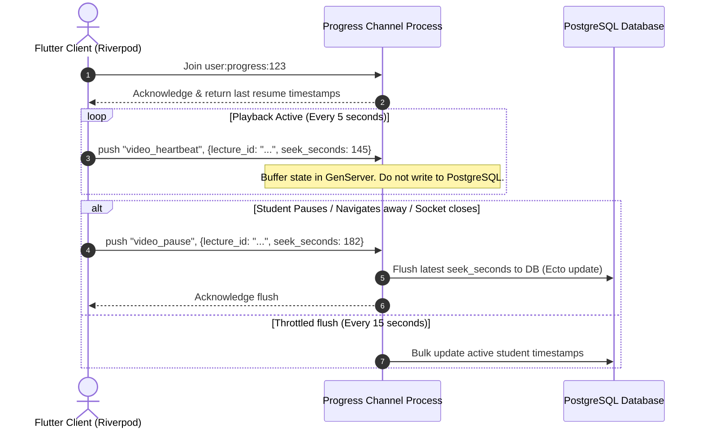
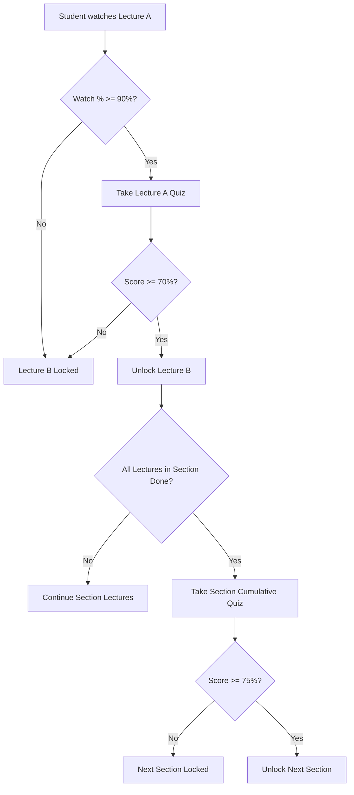
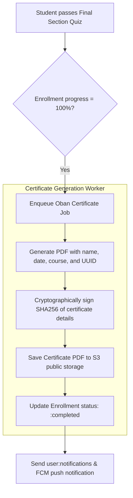

# Course Progress Tracking & Analytics Sync

This document specifies the real-time progress tracking mechanisms, dynamic lecture and section locking systems based on assessment feedback, and the certificate generation pipeline.

---

## 1. Real-time Progress Sync Channel

To ensure seamless multi-device resume capabilities (e.g., starting a video on a mobile device and resuming it on a tablet) without overloading the primary database, progress tracking uses the `user:progress:<user_id>` Phoenix Channel.

### Real-Time Ingestion Architecture



### Heartbeat Schema Payload

#### Event: `video_heartbeat`
*   **Payload**:
    ```json
    {
      "course_id": "c7a8b9c0-1234-5678-abcd-ef0123456789",
      "lecture_id": "e8a9b0c1-5678-1234-abcd-ef0123456789",
      "seek_seconds": 185,
      "percent_watched": 42.5
    }
    ```

#### Event: `lecture_complete`
Sent by the client when the video finishes playing or the text content is read.
*   **Payload**:
    ```json
    {
      "course_id": "c7a8b9c0-1234-5678-abcd-ef0123456789",
      "lecture_id": "e8a9b0c1-5678-1234-abcd-ef0123456789"
    }
    ```
*   **Server Verification Response**:
    *   If the lecture has an associated quiz, the server replies with status `quiz_required: true`, instructing the Flutter client to lock the next lecture until the quiz is completed.

---

## 2. Assessment-Gated Progression Blocking Logic

To ensure actual learning upskilling, progress through a course is strictly locked behind assessment pass criteria. A student cannot access downstream lectures or sections until they satisfy the validation metrics.

### Lock and Unlock Rules



### Ash Resource Representation: `EnrollmentProgress`
To implement this fast, the database maintains a dense matrix of completed lectures per enrollment, modeled as an Ash Resource.

```elixir
defmodule Josjob.Courses.EnrollmentProgress do
  use Ash.Resource,
    otp_app: :josjob,
    data_layer: AshPostgres.DataLayer

  postgres do
    table "enrollment_progresses"
    repo Josjob.Repo
  end

  attributes do
    uuid_primary_key :id
    attribute :completed_at, :utc_datetime
    attribute :watch_percentage, :float
    attribute :highest_quiz_score, :float
    attribute :is_unlocked, :boolean, default: false, allow_nil?: false
  end

  relationships do
    belongs_to :enrollment, Josjob.Courses.Enrollment
    belongs_to :lecture, Josjob.Courses.Lecture
  end

  actions do
    defaults [:read, :destroy]
    create :create
    update :update
  end
end
```

### Backend Validation Function (Ecto Transaction)
```elixir
defmodule Josjob.Courses.ProgressionService do
  alias Josjob.Courses.{Enrollment, EnrollmentProgress}

  # Evaluates and updates student progress pointers when a quiz is passed using Ash
  def process_quiz_pass(student_id, course_id, current_lecture_id, score) do
    Ash.run_transaction(Josjob.Courses, fn ->
      # 1. Retrieve user enrollment and progress records via Ash resources
      with {:ok, enrollment} <- 
             Enrollment
             |> Ash.Query.filter(student_id == ^student_id and course_id == ^course_id)
             |> Ash.read_one(),
           {:ok, progress} <-
             EnrollmentProgress
             |> Ash.Query.filter(enrollment_id == ^enrollment.id and lecture_id == ^current_lecture_id)
             |> Ash.read_one(),
           
           # 2. Update quiz score and mark lecture completed if criteria met
           {:ok, _updated_progress} <-
             Ash.update(progress, :update, %{
               highest_quiz_score: max(progress.highest_quiz_score || 0.0, score),
               completed_at: DateTime.utc_now()
             }) do
        
        # 3. Check if all section requirements are met
        if section_completed?(enrollment, current_lecture_id) do
          # Trigger Section Quiz lock unlock
          # Else unlock the next sequential lecture
          unlock_next_lecture(enrollment, current_lecture_id)
        else
          {:ok, :in_progress}
        end
      else
        {:error, reason} -> Ash.rollback(reason)
      end
    end)
  end
end
```

---

## 3. Graduation & Certificate Generation

Once the final section-level assessment is passed and overall completion reaches $100\%$, the platform awards the student a secure, verified Certificate of Completion.

### Certificate Pipeline



*   **Cryptographic Verification**:
    To prevent fraud, the backend generates a SHA256 hash containing `student_name`, `course_title`, `completion_date`, and a secret key. This hash is printed as a QR code verification link on the certificate PDF, allowing external employers to verify the authenticity of the degree against the platform’s public verification endpoint (`GET /verify/certificate/:hash`).
