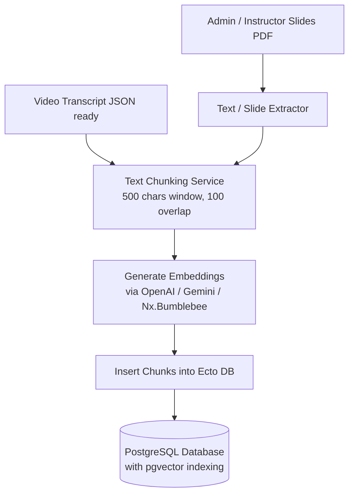
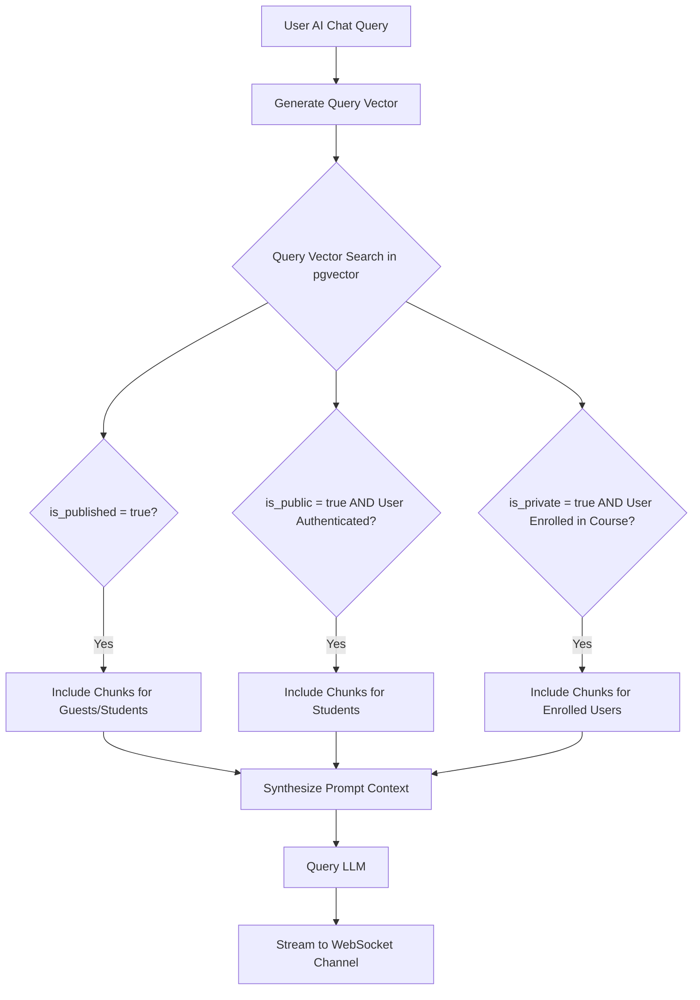
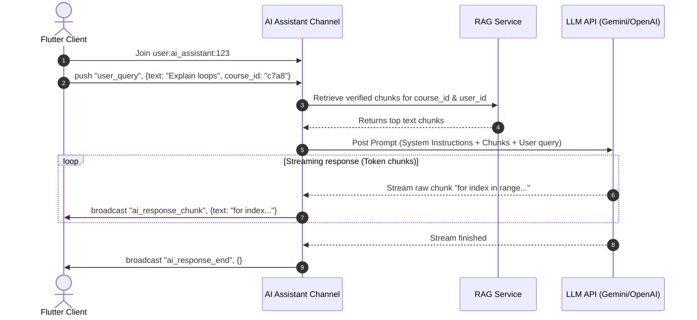

# AI Assistant & RAG (Retrieval-Augmented Generation) System

This document specifies the RAG ingestion pipeline, visibility-aware vector schemas, database indexing, and real-time AI streaming channels.

---

## 1. Ingestion & Vectorization Pipeline

To provide contextual AI coaching, the platform processes and embeds lecture transcripts, slides, and files into a vectorized format. The processing is managed asynchronously via **Oban** background workers.

### Ingestion Flow Diagram



### Ingestion Specifications
1.  **Text Chunking**: 
    Document text is split using a character-based sliding window:
    *   **Chunk Size**: 500 characters.
    *   **Overlap**: 100 characters (to preserve semantic boundaries).
2.  **Embedding Generation**:
    *   Vectors are generated using a 384-dimension (e.g. `all-MiniLM-L6-v2`) or 1536-dimension (e.g. `text-embedding-3-small`) model.
    *   For on-premise execution, Elixir’s **Nx** and **Bumblebee** libraries execute local Hugging Face embedding pipelines in the OTP tree. For cloud execution, the **Req** client handles external REST calls.

---

## 2. Visibility-Aware Vector Database Schema

To prevent data leaks and enforce copyright controls, vector chunks must inherit strict visibility rules.



### Database Tables (pgvector integration)

```sql
-- Enable pgvector extension
CREATE EXTENSION IF NOT EXISTS vector;

-- Table to store text chunks and their embeddings
CREATE TABLE document_embeddings (
    id uuid PRIMARY KEY DEFAULT gen_random_uuid(),
    content text NOT NULL,
    embedding vector(1536) NOT NULL, -- 1536 dimensions for OpenAI/Gemini
    visibility VARCHAR(20) NOT NULL, -- 'private', 'public', 'published'
    course_id uuid REFERENCES courses(id) ON DELETE CASCADE,
    lecture_id uuid REFERENCES lectures(id) ON DELETE CASCADE,
    instructor_id uuid REFERENCES users(id) ON DELETE CASCADE,
    metadata jsonb NOT NULL DEFAULT '{}',
    inserted_at timestamp(0) without time zone NOT NULL,
    updated_at timestamp(0) without time zone NOT NULL
);

-- Indexing vectors using HNSW for fast cosine similarity search
CREATE INDEX document_embeddings_hnsw_idx ON document_embeddings 
USING hnsw (embedding vector_cosine_ops);
```

### Ash Resource Map
```elixir
defmodule Stellar.AI.DocumentEmbedding do
  use Ash.Resource,
    otp_app: :stellar,
    data_layer: AshPostgres.DataLayer

  postgres do
    table "document_embeddings"
    repo Stellar.Repo
  end

  attributes do
    uuid_primary_key :id
    attribute :content, :string, allow_nil?: false
    attribute :embedding, Pgvector.Ecto.Vector, allow_nil?: false
    attribute :visibility, :string, allow_nil?: false # "private", "public", "published"
    attribute :metadata, :map, default: %{}, allow_nil?: false
  end

  relationships do
    belongs_to :course, Stellar.Courses.Course
    belongs_to :lecture, Stellar.Courses.Lecture
    belongs_to :instructor, Stellar.Accounts.User
  end

  actions do
    defaults [:read, :destroy]
    create :create
  end
end
```

---

## 3. Contextual Vector Retrieval

When searching vectors, the PostgreSQL query applies metadata filters based on the user's authentication and active enrollments:

```elixir
defmodule Stellar.AI.RAGService do
  alias Stellar.AI.DocumentEmbedding

  # Queries the database for relevant chunks, enforcing access controls using Ash
  def retrieve_context(query_vector, user_id, current_course_id) do
    # Fetch user enrollments using Stellar.Courses domain
    enrolled_course_ids = Stellar.Courses.list_enrolled_course_ids(user_id)

    DocumentEmbedding
    # Vector similarity selection using <=> (cosine distance via fragment)
    |> Ash.Query.order_by(fragment("embedding <=> ?", ^query_vector))
    # Visibility controls:
    # 1. 'published' items are available to everyone.
    # 2. 'public' items are available to registered users (user_id is verified).
    # 3. 'private' items are restricted strictly to courses the student is enrolled in.
    |> Ash.Query.filter(
      visibility == "published" or
      (visibility == "public" and not is_nil(^user_id)) or
      (visibility == "private" and course_id in ^enrolled_course_ids)
    )
    |> Ash.Query.limit(5)
    |> Ash.read!()
  end
end
```

---

## 4. Real-time AI Assistant Channel (`user:ai_assistant:<user_id>`)

The AI tutoring assistant streams LLM tokens back to the student over a Phoenix Channel.

### Stream Protocol Sequence



### Channel Communication Payloads

#### 1. Ingress: `user_query`
*   **Payload**:
    ```json
    {
      "text": "What does section 2 say about numeric logic?",
      "course_id": "c7a8b9c0-1234-5678-abcd-ef0123456789",
      "lecture_id": "e8a9b0c1-5678-1234-abcd-ef0123456789"
    }
    ```

#### 2. Egress Broadcast: `ai_response_chunk`
*   **Payload**: `{"text": "Section 2 "}`
*   **Payload**: `{"text": "explains that "}`

#### 3. Egress Broadcast: `ai_response_end`
*   **Payload**: `{}` (indicates text completion, telling the client to render final Markdown format).

---

## 5. Flutter UI Chat Panel (Riverpod)

The Flutter app maps WebSocket streaming text packages directly into a dynamic message bubble list.

```dart
class ChatMessage {
  final String sender; // "user" or "ai"
  final String text;
  final bool isStreaming;

  ChatMessage({required this.sender, required this.text, this.isStreaming = false});
}

class AIAssistantNotifier extends StateNotifier<List<ChatMessage>> {
  final PhoenixSocket _socket;
  final String _courseId;
  PhoenixChannel? _channel;
  String _activeStreamText = "";

  AIAssistantNotifier(this._socket, this._courseId) : super([]) {
    _joinChannel();
  }

  void _joinChannel() {
    _channel = _socket.addChannel(topic: "user:ai_assistant:${_socket.userId}");
    _channel?.join();

    _channel?.on("ai_response_chunk", (payload, ref) {
      final chunk = payload["text"] as String;
      _activeStreamText += chunk;
      
      // Update the last message in state
      if (state.isNotEmpty && state.last.isStreaming) {
        state = [
          ...state.sublist(0, state.length - 1),
          ChatMessage(sender: "ai", text: _activeStreamText, isStreaming: true)
        ];
      } else {
        state = [
          ...state,
          ChatMessage(sender: "ai", text: _activeStreamText, isStreaming: true)
        ];
      }
    });

    _channel?.on("ai_response_end", (payload, ref) {
      if (state.isNotEmpty && state.last.isStreaming) {
        state = [
          ...state.sublist(0, state.length - 1),
          ChatMessage(sender: "ai", text: _activeStreamText, isStreaming: false)
        ];
      }
      _activeStreamText = "";
    });
  }

  void askQuestion(String question) {
    state = [...state, ChatMessage(sender: "user", text: question)];
    _channel?.push(event: "user_query", payload: {
      "text": question,
      "course_id": _courseId
    });
  }

  @override
  void dispose() {
    _channel?.leave();
    super.dispose();
  }
}
```
