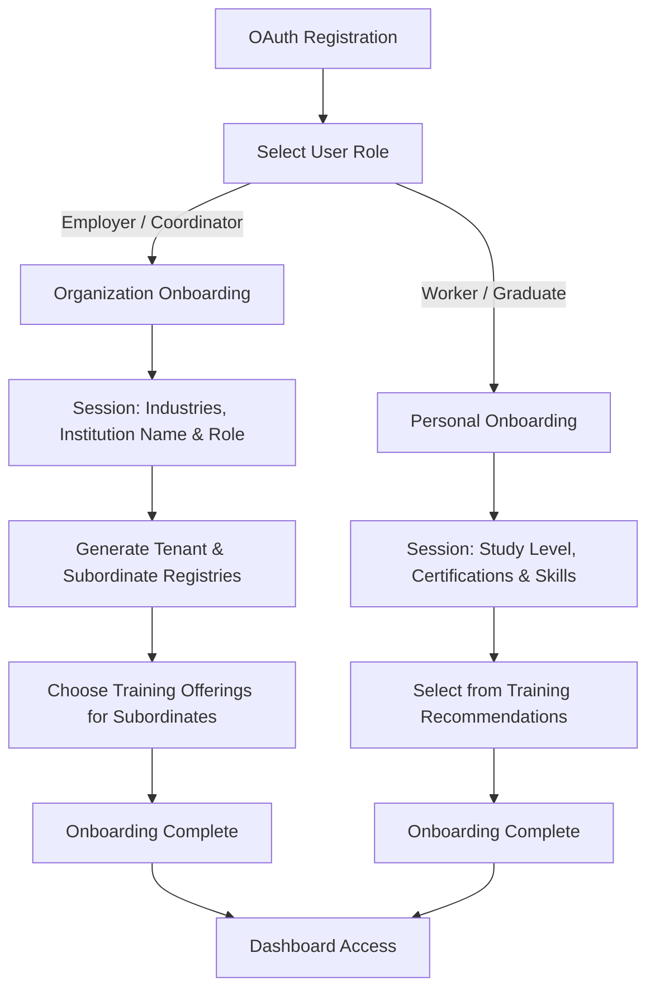

# User Onboarding Flow Specification

This document specifies the onboarding workflow for the four different user roles, the attribute-based multi-tenancy architecture used to isolate organizational data, session state configurations for information gathering, and training matching/recommendations.

---

## 1. Onboarding Flow Overview

The platform supports four types of user roles, each undergoing a customized onboarding flow after their initial OAuth/registration handshake.



### User Roles Matrix

| Role | Multi-Tenancy Scope | Session Data Collected | Onboarding Final Step |
| :--- | :--- | :--- | :--- |
| **Employer** | Tenant Owner (`tenant_id` matches company) | Business Industries, Company Name, Role in Company | Register workers & assign training programs |
| **Vocational Coordinator** | Tenant Owner (`tenant_id` matches university) | Business Industries, University/College Name, Role in Institution | Register students/graduates & assign training programs |
| **Individual Worker** | Self-scoped Tenant (`tenant_id` matches user ID or `nil`) | Level of Study, Certifications list, Skills list | Select from training recommendations (industry-matched) |
| **Fresh Graduate** | Self-scoped Tenant (`tenant_id` matches user ID or `nil`) | Level of Study, Certifications list, Skills list | Select from training recommendations (industry-matched) |

---

## 2. Multi-Tenancy Architecture (Ash Attribute-based Strategy)

To enforce isolation between companies (Employers) and academic institutions (Vocational Training Coordinators), the platform uses **Ash Attribute-based Multi-Tenancy** (`strategy :attribute`).

### Key Configurations

*   **Attribute Scope**: The primary resource containing organization/group records is the `Tenant` resource. Resources that are scoped to an organization must define `tenant_id` as the tenant attribute.
*   **Subordinates Isolation**: Subordinate users (e.g. workers registered under an employer, students registered under a coordinator) inherit their manager's `tenant_id` upon creation, ensuring they can only see training offerings designated for their organization.

### Ash Resource Models

#### 1. Tenant Resource (`Josjob.Accounts.Tenant`)

```elixir
defmodule Josjob.Accounts.Tenant do
  use Ash.Resource,
    otp_app: :josjob,
    data_layer: AshPostgres.DataLayer

  postgres do
    table "tenants"
    repo Josjob.Repo
  end

  attributes do
    uuid_primary_key :id
    attribute :name, :string, allow_nil?: false      # Company Name or University Name
    attribute :type, :string, allow_nil?: false      # "company" or "university"
    
    timestamps()
  end

  relationships do
    has_many :users, Josjob.Accounts.User
  end

  actions do
    defaults [:read, :destroy]
    create :create
  end
end
```

#### 2. User Resource (`Josjob.Accounts.User`)

The User resource implements `strategy :attribute` to filter queries and mutations automatically.

```elixir
defmodule Josjob.Accounts.User do
  use Ash.Resource,
    otp_app: :josjob,
    data_layer: AshPostgres.DataLayer,
    extensions: [AshAuthentication]

  multitenancy do
    strategy :attribute
    attribute :tenant_id
  end

  postgres do
    table "users"
    repo Josjob.Repo
  end

  attributes do
    uuid_primary_key :id
    attribute :email, :string, allow_nil?: false
    attribute :role, :string, allow_nil?: false        # "employer", "coordinator", "worker", "graduate", "superuser"
    attribute :tenant_id, :uuid                        # References Josjob.Accounts.Tenant
    
    # For Worker & Graduate onboarding
    attribute :level_of_study, :string                 # "high_school", "undergraduate", "postgraduate", etc.
    attribute :onboarding_completed, :boolean, default: false, allow_nil?: false

    timestamps()
  end

  relationships do
    belongs_to :tenant, Josjob.Accounts.Tenant, allow_nil?: true
    has_many :certifications, Josjob.Accounts.Certification
    has_many :skills, Josjob.Accounts.UserSkill
  end

  actions do
    defaults [:read, :destroy]
    
    create :register do
      accept [:email, :role, :tenant_id, :level_of_study]
    end

    update :complete_onboarding do
      change set_attribute(:onboarding_completed, true)
    end
  end
end
```

---

## 3. Onboarding Session Details

The onboarding process collects profile information in a conversational, progressive session.

### Session Step A: Industry Configuration (Many-to-Many)

Both organizational and individual users select one or more business industries (e.g., "Software Engineering", "Healthcare", "Manufacturing", "Finance") that apply to their work scope.

```elixir
# Join Resource: Josjob.Accounts.UserIndustry
defmodule Josjob.Accounts.UserIndustry do
  use Ash.Resource,
    otp_app: :josjob,
    data_layer: AshPostgres.DataLayer

  postgres do
    table "user_industries"
    repo Josjob.Repo
  end

  attributes do
    uuid_primary_key :id
  end

  relationships do
    belongs_to :user, Josjob.Accounts.User, allow_nil?: false, primary_key?: true
    belongs_to :industry, Josjob.Courses.Industry, allow_nil?: false, primary_key?: true
  end

  actions do
    defaults [:read, :destroy]
    create :create
  end
end
```

### Session Step B: Credentials Gathering (Workers & Graduates)

For individual workers and fresh graduates, the session collects credentials to customize their baseline metrics:
*   **Study Level**: Stored directly as `:level_of_study` on the `User` resource.
*   **Certifications**: Stored in a nested relationship (`has_many :certifications`).
*   **Skills**: Standardized skill tags linked via a join table.

```elixir
# Certification Resource
defmodule Josjob.Accounts.Certification do
  use Ash.Resource,
    otp_app: :josjob,
    data_layer: AshPostgres.DataLayer

  postgres do
    table "certifications"
    repo Josjob.Repo
  end

  attributes do
    uuid_primary_key :id
    attribute :name, :string, allow_nil?: false
    attribute :issuing_authority, :string
    
    timestamps()
  end

  relationships do
    belongs_to :user, Josjob.Accounts.User
  end

  actions do
    defaults [:read, :destroy]
    create :create
  end
end
```

---

## 4. Subordinate Registration Mechanics

Employers and Coordinators can invite or bulk-register their subordinates under their own Tenant scope:

1.  **Employer Subordinate Registration**: Employers register their employees (`workers`). When created, the API applies the employer's `tenant_id` automatically.
2.  **Coordinator Subordinate Registration**: Coordinators register their university students / fresh graduates (`graduates`). When created, the API applies the coordinator's `tenant_id` automatically.

```elixir
defmodule Josjob.Accounts.SubordinateService do
  # Bulk registers subordinate users within the manager's tenant scope
  def register_subordinates(manager_user, subordinate_params_list) do
    # Verify manager permissions using ash_rbac
    if manager_user.role in ["employer", "coordinator"] do
      # Set tenant context to enforce attribute-based scoping
      Ash.run_transaction(Josjob.Accounts, fn ->
        Enum.map(subordinate_params_list, fn params ->
          Josjob.Accounts.User
          |> Ash.Changeset.for_create(:register, %{
            email: params.email,
            role: if(manager_user.role == "employer", do: "worker", else: "graduate"),
            tenant_id: manager_user.tenant_id
          })
          |> Ash.create!(tenant: manager_user.tenant_id)
        end)
      end)
    else
      {:error, :forbidden}
    end
  end
end
```

---

## 5. Training Match & Selection Engine

### Organization Workflow (Employers & Coordinators)
At the final step of organization onboarding, the manager selects from a catalog of courses and programs. The selected programs are linked as `TrainingOfferings` for their subordinates.

```elixir
defmodule Josjob.Courses.TrainingOffering do
  use Ash.Resource,
    otp_app: :josjob,
    data_layer: AshPostgres.DataLayer

  multitenancy do
    strategy :attribute
    attribute :tenant_id
  end

  postgres do
    table "training_offerings"
    repo Josjob.Repo
  end

  attributes do
    uuid_primary_key :id
    attribute :tenant_id, :uuid, allow_nil?: false
    attribute :course_id, :uuid, allow_nil?: false
    
    timestamps()
  end

  relationships do
    belongs_to :tenant, Josjob.Accounts.Tenant
    belongs_to :course, Josjob.Courses.Course
  end

  actions do
    defaults [:read, :destroy]
    create :create
  end
end
```

### Recommendation Workflow (Individual Workers & Fresh Graduates)
For individuals, the platform queries training programs (courses) and recommends options matching the industry tags they configured during onboarding:

```elixir
defmodule Josjob.Courses.RecommendationService do
  alias Josjob.Courses.Course
  alias Josjob.Accounts.UserIndustry

  # Returns recommended courses matching the user's selected onboarding industries
  def get_recommendations(user) do
    # 1. Fetch the user's chosen industries
    {:ok, user_industries} = 
      UserIndustry
      |> Ash.Query.filter(user_id == ^user.id)
      |> Ash.read()

    industry_ids = Enum.map(user_industries, & &1.industry_id)

    # 2. Query courses associated with those industries
    Course
    |> Ash.Query.filter(industry_id in ^industry_ids and is_published == true)
    |> Ash.read!()
  end
end
```
