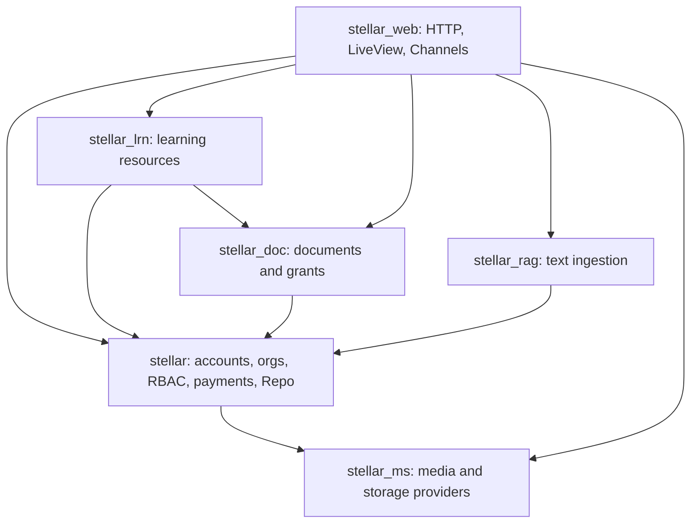
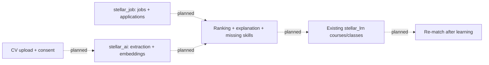

# Project map: JosJob on Stellar

Analyzed on 2026-11-11 at commit `31d9fdc0cb9a244c86eaa835435ee6f26c72535e`.
Selected Graphify repository: `ZygmaCore/JosJob` (the local origin URL still
uses `ZygmaCore/job-seeker-ai`). The indexed commit matches this checkout.
This is a source-based orientation map, not a runtime certification. Recheck
the current files when code changes.

Working-tree update on branch `feat/job-listings`: the PRD's listing slice is
implemented in `StellarJob.Job` / `StellarJob.Listings`, the `/api/jobs` CRUD
controller, and the Flutter jobs board/editor plus dashboard vacancies view.
See [the jobs API and verification notes](api/jobs.md). The indexed commit and
the historical implementation inventory below predate this branch; CV analysis,
AI ranking, saved jobs and applications remain separate planned work.

## Read this first

JosJob renovates the existing Stellar learning and placement platform. The new
product loop is **Match → Gap → Learn → Re-match**: upload a CV, rank jobs,
explain missing skills, recommend learning, then re-run matching. The learning
foundation is implemented; the jobs/CV loop is still planned at this snapshot.

For product intent, start with [the master PRD](../PRD/PRD.md),
[decisions](../PRD/DECISIONS.md), [backend scope](../PRD/backdev/PRD.md), and
[frontend scope](../PRD/frontdev/PRD.md). Unresolved choices are recorded in
[backend questions](../PRD/backdev/OPEN-QUESTIONS.md),
[frontend questions](../PRD/frontdev/OPEN-QUESTIONS.md), and
[metrics](../PRD/METRICS.md). Recommendations in those files are not decisions.
For implemented behavior, use the source and tests rather than older prose.

The backend is a **modular monolith**: ten Elixir umbrella apps, one OTP release
named `stellar`, one Phoenix endpoint, and one shared `Stellar.Repo`. Flutter is
the unified client in `apps/stellar_fe`; it is outside the Mix app list.
There is no need to reconstruct the abandoned Go/TypeScript/Python microservice
design. Source: [root Mix project](../mix.exs).

## App ownership and dependency graph

The arrows below are declared `in_umbrella` dependencies, read from each app's
`mix.exs`. They are not a complete function-call graph.



| App | Current responsibility | Entry points |
| --- | --- | --- |
| `stellar` | Accounts/auth, organizations/memberships, reference data, RBAC, invitations, Stripe billing, shared database and seeding | [application](../apps/stellar/lib/stellar/application.ex), [authorization](../apps/stellar/lib/stellar/authz.ex), [release tasks](../apps/stellar/lib/stellar/release.ex) |
| `stellar_web` | All HTTP routes/controllers, API gates, LiveView CMS, sockets, presence | [router](../apps/stellar_web/lib/stellar_web/router.ex), [endpoint](../apps/stellar_web/lib/stellar_web/endpoint.ex), [LiveView auth](../apps/stellar_web/lib/stellar_web/live/live_auth.ex) |
| `stellar_lrn` | Implemented Section/Course/Class/Enrollment resources, catalog scoping, materials, live admission, sample learning data | [learning domain](../apps/stellar_lrn/lib/stellar_lrn/learning.ex), [resources](../apps/stellar_lrn/lib/stellar_lrn/learning), [seeds](../apps/stellar_lrn/lib/stellar_lrn/seeds.ex) |
| `stellar_doc` | Implemented document metadata and access grants; ownership/org/share visibility | [document domain](../apps/stellar_doc/lib/stellar_doc/documents.ex), [resources](../apps/stellar_doc/lib/stellar_doc/documents) |
| `stellar_ms` | Implemented Cloudflare Stream VOD, Cloudflare Realtime SFU/TURN, S3-compatible upload signing; no umbrella dependencies | [VOD facade](../apps/stellar_ms/lib/stellar_ms.ex), [live facade](../apps/stellar_ms/lib/stellar_ms/realtime.ex), [storage facade](../apps/stellar_ms/lib/stellar_ms/storage.ex) |
| `stellar_rag` | Implemented document extraction and ingestion to Atomic Server; not a completed conversational assistant | [indexer](../apps/stellar_rag/lib/stellar_rag/indexer.ex), [extractor](../apps/stellar_rag/lib/stellar_rag/extractor.ex), [Atomic client](../apps/stellar_rag/lib/stellar_rag/atomic_client.ex) |
| `stellar_ai` | Minimal Jido HeadHunter/TeacherAssistant and example actions; CV analysis/matching planned | [HeadHunter](../apps/stellar_ai/lib/agents/head_hunter.ex), [TeacherAssistant](../apps/stellar_ai/lib/agents/teacher_assistant.ex) |
| `stellar_job` | Generated `hello/0` stub; jobs/applications backend planned | [module](../apps/stellar_job/lib/stellar_job.ex) |
| `stellar_quiz` | Generated stub; quiz UI exists separately in Flutter | [module](../apps/stellar_quiz/lib/stellar_quiz.ex) |
| `stellar_rt` | Generated stub; current sockets/live signaling already live in `stellar_web` | [module](../apps/stellar_rt/lib/stellar_rt.ex) |
| `stellar_fe` | Flutter client with real services for auth/onboarding/catalog/documents/live; jobs and some dashboard/quiz content remain sample UI | [bootstrap and routes](../apps/stellar_fe/lib/main.dart), [services](../apps/stellar_fe/lib/services), [theme](../apps/stellar_fe/lib/theme/app_theme.dart) |

Keep media/storage integrations behind `StellarMs`, `StellarMs.Realtime`, and
`StellarMs.Storage`. Keep `stellar_ms` a leaf app to avoid dependency cycles.
Feature resources belong in their owning app; database migrations remain under
[`apps/stellar/priv/repo/migrations`](../apps/stellar/priv/repo/migrations).
All Ash resources use the shared Repo. Domain registration is in
[`config/config.exs`](../config/config.exs).

`Stellar.Release` dynamically invokes `StellarLrn.Seeds` via `apply/3`; do not
replace that with a core → learning dependency, which would close a cycle.
New feature apps need explicit runtime dependencies and caller `in_umbrella`
dependencies before use; merely listing an app in the release does not wire APIs.

## Connected domain model

```mermaid
flowchart LR
  user[User] --> membership[Membership: user + organization]
  organization[Organization] --> membership
  membership --> membershipRole[MembershipRole]
  membershipRole --> role[Role]
  role --> rolePermission[RolePermission]
  rolePermission --> permission[Permission]
  section[Section] --> course[Course]
  course --> class[Class: organization + instructor]
  class --> enrollment[Enrollment: student + status]
  user --> enrollment
  user --> document[Document: owner + organization + URL]
  course -. course_id UUID, no foreign key .-> document
  document --> grant[DocumentAccessGrant: recipient + validity]
  user --> grant
```

Sections/courses are shared to organizations through join resources. Courses
also have industry joins, public/private visibility, price and currency.
The instructor belongs to a **Class**, not Course. Materials for a class are
course documents plus its instructor's documents with no `course_id`.
See [Course](../apps/stellar_lrn/lib/stellar_lrn/learning/course.ex),
[Class](../apps/stellar_lrn/lib/stellar_lrn/learning/class.ex), and
[materials/live helpers](../apps/stellar_lrn/lib/stellar_lrn/learning.ex).

Authorization is layered: browser/session or JWT authentication, route gates,
LiveView mount/reconnect gates, and explicit query scoping/domain helpers.
Many reads use `authorize?: false`; a resource's existence does not establish
tenant isolation. Preserve the caller's checks when reusing those reads.
`Stellar.Authz` derives permissions from active memberships and role joins;
superuser is the database `is_superuser` flag. API student scoping uses
[`StudentScope.org_ids/1`](../apps/stellar_web/lib/stellar_web/controllers/api/student_scope.ex).

## Feature traces: UI → transport → domain/provider

| Feature | Connections to inspect together | Existing verification |
| --- | --- | --- |
| Sign-in/session | Flutter `services/session.dart` → `auth_api.dart` → `/api/auth/{register,login,google,refresh}` → `Api.AuthController` → `Stellar.Accounts`; browser OAuth uses `StellarWeb.AuthController` and a session | [API auth tests](../apps/stellar_web/test/stellar_web/controllers/api/auth_controller_test.exs), [registration tests](../apps/stellar/test/stellar/accounts/registration_test.exs), [login E2E](../e2e/tests/login.spec.ts) |
| Offline onboarding | Flutter optimistic Session updates → `SyncEngine` → Drift/SQLite outbox → `/api/onboarding/progress` and `/api/onboarding/answers` → `Stellar.Accounts.Onboarding.Sync` | [backend sync tests](../apps/stellar/test/stellar/accounts/onboarding_sync_test.exs), [Flutter answers tests](../apps/stellar_fe/test/put_answers_test.dart) |
| Catalog/enrollment | Flutter `courses_api.dart`/explore UI → `/api/catalog/courses`, `/api/classes/:id/enroll`, `/api/me/enrollments` → catalog/enrollment controllers + StudentScope → `StellarLrn.Learning` | [learning admission tests](../apps/stellar_lrn/test/stellar_lrn/learning/live_gate_test.exs), [admin enrollment tests](../apps/stellar_web/test/stellar_web/live/admin/enrollment_live_test.exs) |
| Paid enrollment | EnrollmentController `create_intent`/`confirm` → `Stellar.Payments.Billing` → Stripe client; server supplies the price and confirms payment before enrollment | [Stripe webhook tests](../apps/stellar/test/stellar/payments/stripe/webhook_test.exs), [form encoder tests](../apps/stellar/test/stellar/payments/stripe/form_encoder_test.exs) |
| Document upload/sharing | Flutter `documents_api.dart` → `/api/documents` and grants endpoints → DocumentController → `StellarMs.Storage` signing + `StellarDoc.Documents` visibility/grant helpers | [upload tests](../apps/stellar_web/test/stellar_web/controllers/api/document_upload_test.exs), [Flutter API tests](../apps/stellar_fe/test/documents_api_test.dart), [document LiveView tests](../apps/stellar_web/test/stellar_web/live/my_document_live_test.exs) |
| Current VOD upload | Flutter `vod_document_api.dart` → `/api/vod/documents/upload-url`, `/api/vod/documents`, status → VodDocumentController → `StellarMs`/Cloudflare Stream + Document metadata | [Flutter VOD document tests](../apps/stellar_fe/test/vod_document_api_test.dart), [media tests](../apps/stellar_ms/test/stellar_ms) |
| Live class | Flutter `live/service/signaling_client.dart` + `live_session_controller.dart` → JWT `/socket` → `live_room:class:<class_id>[:mode]` → LiveRoomChannel → `Learning.live_role/2` + Presence + `StellarMs.Realtime` | [channel tests](../apps/stellar_web/test/stellar_web/channels/live_room_channel_test.exs), [learning gate tests](../apps/stellar_lrn/test/stellar_lrn/learning/live_gate_test.exs), [Flutter live model tests](../apps/stellar_fe/test/live/live_models_test.dart) |
| Teacher invitations | Flutter admin/invite screens → `/api/admin/teacher-invitations` and public token-gated `/api/invitations/:token` → invitation controllers → `Stellar.Invitations.Service`, account/RBAC provisioning, mailer | [service tests](../apps/stellar/test/stellar/invitations/service_test.exs), [API tests](../apps/stellar_web/test/stellar_web/controllers/api/invitation_controller_test.exs) |
| RAG ingestion | `/rag` → RagLive → `Indexer.ingest/4` → Xberg text extraction → AtomicClient database/atom requests; namespace uses organization + course | [RAG tests](../apps/stellar_rag/test) |
| Admin management | Router permission pipelines + authenticated live sessions → `live/admin/*` → core, learning, document domains; organization/permission assigns via LiveAuth | [LiveView tests](../apps/stellar_web/test/stellar_web/live/admin), [navigation tests](../apps/stellar_web/test/stellar_web/admin_nav_test.exs) |

These tests are navigation pointers, not a claim of exhaustive coverage or a
passing suite. The mapping was established by source inspection.

## Frontend conventions and integration boundaries

- `main.dart` restores Session, guards named routes, and chooses the home screen
  by role, organization approval, and mandatory onboarding status. Signed-in web
  startup warms SQLite WASM through AppBootstrap before starting the outbox.
- `Session` is a `ChangeNotifier`; `runAuthed` handles token refresh/retry.
  Tokens/user snapshots use `TokenStore` and secure storage. Do not assume the
  Riverpod/ElectricSQL stack in older architecture prose is implemented.
- The implemented outbox covers **onboarding progress and answers**. It uses
  idempotent SETs, last-write-wins answers, reconnect/startup replay, and retry
  backoff. This is not evidence of whole-database offline replication.
- `ApiConfig` reads `API_BASE_URL` and `GOOGLE_CLIENT_ID` at Flutter build time;
  changing server environment variables alone cannot update a built web bundle.
- Feature folders commonly use Dart `part`/`part of` libraries with private
  widgets; add imports to the entry library. Reuse `AppColors`/`Bp` tokens.
  Some newer feature/service files are standalone, so inspect neighboring code.
- At the indexed baseline, the jobs board read hard-coded `jobs/data/jobs_data.dart`.
  On `feat/job-listings`, that data is preserved as
  [historical test fixtures](../apps/stellar_fe/test/fixtures/legacy_job_samples.dart)
  and the production board uses the API. Fixture match percentages are invented,
  not AI results.

## Planned JosJob additions, separate from working features



The PRD assigns job/application resources to `stellar_job`, CV extraction and
matching to `stellar_ai`, file reuse to `stellar_doc`, and HTTP endpoints to
`stellar_web`. Proposed `/api/jobs` and `/api/cv` contracts are absent from the
current router. Gemini primary, localhost-only 9Router fallback, asynchronous
analysis through Oban, reproducible ranking, missing-skill course links, and CV
consent/deletion are requirements, not completed implementation.

Final product decisions include employer-posted plus synthetic jobs (scraping
cancelled), free job access for graduates, and learning monetization. Ranking
weights, model pinning, application statuses, and other open choices still need
their designated owners. Do not turn PRD recommendations into assumed facts.

## Gotchas and documentation drift

1. `CLAUDE.md` still describes Flutter as UI-only and learning/RAG as stubs;
   the actual services/resources above supersede those descriptions. It also
   places historical Courses resources in core; current learning resources use
   the `StellarLrn.Learning` namespace in `stellar_lrn`.
2. README/older architecture docs mention `/admin`/AshAdmin and a sign-in path.
   The current router instead serves login at `/` and explicit admin LiveViews;
   it has no `/admin` route. Check routes before documenting a user journey.
3. Flutter's older `services/vod_api.dart` calls `/api/courses` and
   `/api/lectures/*`, which are absent from the current router. Current VOD
   document upload endpoints are a separate contract. Historical lecture tables
   in migrations do not prove current lecture resources/routes exist.
4. Document's module comment still says upload is unavailable; current upload
   controllers and storage facade implement presigned uploads. Document
   `course_id` is an unvalidated relationship UUID, not a declared foreign key.
5. The dedicated `stellar_rt` app is empty, while authenticated notification
   join/ping and live signaling are implemented in `stellar_web`. The notification
   channel is a foundation, not a completed notification delivery system.
6. Class-prefixed live rooms derive host/guest roles on the server. Free/demo
   rooms still accept client roles; the channel documents this limitation and
   client-side publishing enforcement. Preserve that distinction.
7. RAG ingestion currently falls back to another/first organization or
   `default_org` when selecting its namespace. Review that path before treating
   ingestion as strict multi-tenant isolation. Q&A streaming is still planned.
8. Old docs describe Membrane, ElectricSQL, FCM, certificates, and expansive AI
   workflows. Dependency/design mentions are not evidence that those flows run.

## Runtime and checks

[`Stellar.Application`](../apps/stellar/lib/stellar/application.ex) supervises
Repo, DNSCluster, PubSub, AshAuthentication, and Oban. Web supervises Presence,
Telemetry, and Endpoint. Oban has default/media/transcription/mailer queues;
test configuration uses manual execution and the Ecto SQL sandbox.

Tool versions are pinned in [`.tool-versions`](../.tool-versions): Elixir
1.19.5/OTP 27, Erlang 27.3.4.3, Node 24.13.0, Rust 1.96.1. Xberg is configured
for source builds, so Rust/native build tooling matters. The Repo requires
PostgreSQL 16+ and registers `citext`.

Docker full stack: [`docker-compose.fullstack.yml`](../docker-compose.fullstack.yml)
provides ParadeDB (host port 5438), Phoenix (4000), and Flutter/nginx (8081).
The default compose file only defines the database and frontend. Runtime
configuration lives in [`config/runtime.exs`](../config/runtime.exs); frontend
configuration is also baked into its build. Release migrations/seeds use
`Stellar.Release` and scripts in [`rel/overlays/bin`](../rel/overlays/bin).
README describes CI/CD, but this checkout has no `.github` workflow directory
or `.gitlab-ci.yml`; do not assume the pipeline is present here.

Required backend completion check: `mix precommit` (test environment), which
runs compile with warnings as errors, unused dependency unlocking, formatting,
and tests. Inspect diffs afterward because that alias can mutate files.
Frontend changes use `flutter analyze`, `dart format lib`, and appropriate
Flutter tests. Playwright lives in `e2e`; its login test expects Flutter DOM
semantics, so set `BASE_URL` to the Flutter origin (normally 8081), overriding
the config's default 4000, and supply test credentials.

During this analysis, Mix/Elixir were not available on the shell PATH, so the
backend checks could not run. No feature code was changed or runtime integration
exercised. Documentation links and Git diffs were checked locally.

## Graphify index, memory status, and future retrieval

Connection and code queries succeeded on 2026-11-11 after the initial setup
errors were resolved. The user explicitly selected `ZygmaCore/JosJob`:

| Property | Verified value |
| --- | --- |
| Workspace | `fathan-s-workspace` |
| Repository ID | `bf9ffd50-c99b-4f79-96eb-3220dcb0adf1` |
| Branch / readiness | `main`, ready and queryable |
| Indexed commit | `31d9fdc0cb9a244c86eaa835435ee6f26c72535e` (matches local HEAD) |
| Graph build | `7411c7a8-7a63-4e58-9f13-0ee2361ac3ba` |
| Indexed at | `2026-11-11T14:45:24.612494Z` |
| Graph size | 6,090 nodes, 11,211 edges, 409 communities |
| Document coverage | Free plan: README.md only; this map and PRD files must be read locally |

Successful file-neighbor queries connected `StellarLrn.Learning` to course,
class, enrollment, section and document resources, catalog/enrollment
controllers, LiveRoomChannel, ClassLive and learning admission tests. Separate
queries verified Authz's membership/role/permission dependencies and its web
callers, Documents' RBAC/grant resources and controller/LiveView consumers,
and Indexer's Extractor/AtomicClient dependencies and RagLive/test consumers.
Flutter Session symbol lookup and semantic code queries also succeeded.
These are sampled, indexed connections, not a completeness guarantee for every
runtime call; some Dart entries lack source lines/bodies and results can be capped.

Nine self-contained notes with source paths and snapshot context were accepted
by `remember`: architecture, app ownership, media dependency boundaries,
authorization, onboarding outbox scope, implemented/planned features, VOD
contract drift, product decisions, and repository/snapshot navigation.
The save responses confirmed `stored: true`, but subsequent audit recall still
returned no records/turns. Thus durable intake is confirmed; processed or
published recallable memories are **not yet confirmed**. The service reports a
consolidation policy of eight minimum turns and 900 idle seconds; processing
timing is service-controlled.

After processing, an authorized member must open
[repository Memory](https://app.graphify.com/fathan-s-workspace/memory?repo=bf9ffd50-c99b-4f79-96eb-3220dcb0adf1),
choose **Needs review**, inspect each candidate, and **Accept candidate** before
normal recall can return it. This is Graphify's explicit publication policy,
not a reason to repeat the intake writes.

For later work:

1. Confirm the user's intended repository and verify graph freshness against
   local HEAD; this record does not set a client-wide default repository.
2. Recall prior decisions with the selected repository ID and task-specific
   paths/symbols; use audit recall to distinguish unreviewed notes from published
   facts. Do not assume an empty recall means the intake was never saved.
3. Use file neighbors around the relevant feature and node/caller/test queries
   for focused expansion; inspect coverage notes and actual resolved symbols.
4. Read PRD files and this map locally for product decisions and documentation
   drift omitted by document indexing. Prefer code/tests for implemented behavior.
5. Re-read current files for uncommitted or newer changes; the graph describes
   its indexed commit. Avoid resaving the same onboarding notes without a reason.

This checked-in map remains the durable local navigation entry point; its
contents were summarized into memory intake, not imported as a document graph.
