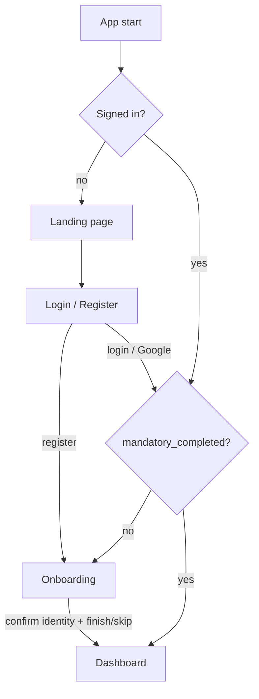

# Auth & Onboarding — Frontend/Backend Integration

This document describes how the unified Flutter web app (`apps/stellar_fe`) was
wired to the Phoenix/Ash backend for **email/password + Google authentication**
and **onboarding**, plus the backend additions that support it. It reflects what
is **implemented** on branch `feat/fe-auth-backend-integration` (not a forward
spec). The base API contract lives in [`docs/api/auth.md`](../api/auth.md); this
doc covers the integration, the new endpoint, and the client behaviour.

> [!NOTE]
> The app is **web-only** and previously **UI-only** (hard-coded sample data).
> This work replaced the simulated auth with real backend calls and added a
> small services layer; the rest of the app remains sample-data driven.

---

## 1. Configuration

Runtime config is injected with `--dart-define` (frontend) and env vars / config
(backend). Nothing secret is committed — the Google client ID/secret live only
in the gitignored `envs/.env` and are read at runtime.

| Where | Key | Purpose | Default |
| :--- | :--- | :--- | :--- |
| FE (`--dart-define`) | `API_BASE_URL` | Backend base URL | `http://localhost:4000` |
| FE (`--dart-define`) | `GOOGLE_CLIENT_ID` | **Web** OAuth client ID; enables the Google button | *(empty → button hidden)* |
| Backend (`envs/.env`) | `GOOGLE_CLIENT_ID` | `aud` validated on the id_token (must match the FE value) | — |
| Backend (config) | `:stellar_web, :cors_origins` | Allowed CORS origins for `/api` | `"*"` (dev) |

`apps/stellar_fe/lib/services/api_config.dart` reads these via
`String.fromEnvironment`.

> [!IMPORTANT]
> The FE and backend **must use the same Web client ID** — on the web, Google
> Identity Services mints the `id_token` with `aud = <web client id>`, and the
> backend rejects a token whose `aud` doesn't match `GOOGLE_CLIENT_ID`.

---

## 2. Backend additions

All changes are additive to `apps/stellar/lib/stellar/accounts/user.ex`,
`google_auth.ex`, and `apps/stellar_web/…/api/auth_controller.ex` + `router.ex`.

### 2.1 User attributes

| Attribute | Type | Notes |
| :--- | :--- | :--- |
| `avatar_url` | string | Populated from the Google `picture` claim |
| `mandatory_completed` | boolean (default `false`) | The mandatory onboarding step ("Who you are") is done |
| `onboarding_progress` | integer 0–100 (default `0`) | Overall onboarding completion percentage |

Migrations: `*_add_mandatory_completed.exs`, `*_add_onboarding_progress.exs`.

### 2.2 Auth response shape

Every auth response (`register` / `login` / `google` / `refresh`) returns:

```json
{
  "user": {
    "id": "uuid",
    "email": "user@example.com",
    "full_name": "Fathan Akram",
    "avatar_url": "https://lh3.googleusercontent.com/…",
    "mandatory_completed": false,
    "onboarding_progress": 0,
    "is_superuser": false
  },
  "token": "eyJ…",
  "refresh_token": "eyJ…"
}
```

`POST /api/auth/google` additionally returns **`"is_new_user": true|false`**
(looked up by email *before* the upsert). Google upsert now stores `full_name`
(from `name`) and `avatar_url` (from `picture`) — previously only `email`.

### 2.3 New endpoint — `POST /api/onboarding/progress`

Bearer-protected (pipeline `:api_auth` → `conn.assigns.current_user`). Updates
the onboarding progress and/or marks the mandatory step complete.

**Request**
```json
{ "progress": 50, "mandatory_completed": true }
```
Both fields optional; `progress` is clamped to `0..100`; `mandatory_completed`
is only ever set to `true` (never unset).

**200 OK** → `{ "user": { …updated user_json… } }` · **401** without a valid
Bearer token.

Backed by the Ash action `User.update_onboarding` (declared
`require_atomic? false` because it uses a non-atomic change function).

### 2.4 CORS

`cors_plug ~> 3.0` at the endpoint (before the router, so preflight `OPTIONS`
is handled):

```elixir
plug CORSPlug,
  origin: Application.compile_env(:stellar_web, :cors_origins, "*"),
  credentials: false
```

`credentials: false` because `/api` is Bearer-only (no cookies) and `"*"` with
`allow-credentials` is an invalid CORS combination. **Lock origins down for
production** via `config :stellar_web, :cors_origins`.

---

## 3. Frontend architecture

A small cross-cutting services layer (plain public libraries under
`apps/stellar_fe/lib/services/`, not `part` files):

| File | Responsibility |
| :--- | :--- |
| `api_config.dart` | Base URL + Google client ID (`--dart-define`) |
| `auth_api.dart` | `AuthApi` (http), models `AuthUser` / `AuthSession`, `AuthException` |
| `token_store.dart` | Token + user persistence over `flutter_secure_storage` |
| `session.dart` | `Session.instance` (`ChangeNotifier`) — app-wide auth state |
| `onboarding_draft.dart` | Client-side onboarding draft store (secure storage) |

- **Errors:** `AuthApi` maps `400/401/422` to friendly English (backend
  messages are Indonesian). Auth screens show a `_FormError` banner; register
  maps 422 field errors (e.g. "email already registered") onto the field.
- **Persistence:** `Session.restore()` runs at startup (`main()` is async);
  the "Remember me" checkbox controls whether the session is written to storage;
  dashboard logout calls `Session.signOut()`.

### 3.1 Google OAuth on Flutter **web** (`google_sign_in ^7.2.0`)

> [!IMPORTANT]
> v7 **removed programmatic web sign-in** — `authenticate()` throws on web. The
> only supported way to obtain an `id_token` is Google's **GIS-rendered button**
> via `renderButton()` from `package:google_sign_in_web/web_only.dart` (add
> `google_sign_in_web` as a direct dependency).

Flow (see `auth/widgets/google_auth.dart`): `GoogleSignIn.instance.initialize(
clientId: …)` once → listen to `authenticationEvents` → on a sign-in event read
`event.user.authentication.idToken` (synchronous getter, nullable) → POST to
`/api/auth/google`. The button is styled via `GSIButtonConfiguration` (white
outline pill) and only appears when `GOOGLE_CLIENT_ID` is set. Sign-in is
**click-only** (no silent auto re-auth). Register the site origin(s) (e.g.
`http://localhost:8080`) under **Authorized JavaScript origins** in Google Cloud
Console, or you get `Error 400: origin_mismatch`.

### 3.2 Auth + onboarding routing

Routing is driven by **`mandatory_completed`**, not "is this a first sign-in".



- **Register** always → onboarding (new users aren't `mandatory_completed`).
- **Login / Google / startup restore** → onboarding when `!mandatory_completed`,
  else dashboard.
- Google `is_new_user` is available but routing uses `mandatory_completed` so a
  returning user who never finished onboarding is still sent there.

### 3.3 Onboarding progress

The identity step ("Let's get to know you") is **mandatory and not skippable**.
Progress is **step-based over sections that actually contain data** — skipping an
optional section does **not** count.

```
progress = round( (1 + filledOptionalSections) / 4 * 100 )
# identity = 1 mandatory section; 3 optional sections (per role path)
# → 25% (identity only), 50%, 75%, 100% (all optional filled)
```

The FE reports progress to `POST /api/onboarding/progress` on confirming
identity (25% + `mandatory_completed: true`) and on each step advance. The
**dashboard overview** shows a "Finish setting up your profile" card
(`_OnboardingProgressCard`, with a progress bar + **Continue**) whenever
`mandatory_completed && onboarding_progress < 100`; it hides at 100%.

### 3.4 Onboarding draft (client-side)

So **Continue onboarding** restores what the user already entered, the flow's
answers are serialized to `flutter_secure_storage`, **keyed by user id**
(`services/onboarding_draft.dart` + `onboarding/data/draft.dart`).

- **Saved** on: confirm identity, each step advance, and leaving to the
  dashboard with a partial profile.
- **Restored** on re-entering onboarding — role + all filled fields/selections;
  the flow **reopens at the first step** (identity is skipped since it's done).
- **Cleared** once the profile reaches 100%.
- Survives reload / re-login on the same browser; **not synced** across devices.

### 3.5 Dashboard user info

The dashboard reads the signed-in user from `Session.instance.user`: the
greeting uses the real first name, and the sidebar/drawer user card shows the
**email** and the **Google avatar image** (falling back to initials).

---

## 4. Running locally

```bash
# 1. Database (ParadeDB/Postgres on :5438)
docker compose -f docker-compose.yml up -d paradedb
mix ecto.create && mix ecto.migrate          # from the umbrella root

# 2. Backend  (reads envs/.env: GOOGLE_CLIENT_ID, POSTGRES_*)
mix phx.server                                # http://localhost:4000

# 3. Frontend
cd apps/stellar_fe
flutter run -d chrome --web-port=8080 \
  --dart-define=API_BASE_URL=http://localhost:4000 \
  --dart-define=GOOGLE_CLIENT_ID=<web-client-id>.apps.googleusercontent.com
```

For Google sign-in, add `http://localhost:8080` (and `http://127.0.0.1:8080`) to
Authorized JavaScript origins for the client ID in Google Cloud Console.

---

## 5. Known limitations / deferred

- **Onboarding answers are not persisted to the backend** — only a client-side
  draft + the `mandatory_completed` / `onboarding_progress` summary. Mapping the
  optional sections to the backend profile table is future work.
- **Refresh-on-401 not wired** — `Session.refresh()` exists and `/api/onboarding/
  progress` is the first authenticated call, but an automatic 401 → refresh →
  retry is not implemented yet.
- **Web token storage** (`flutter_secure_storage` on web) is localStorage +
  WebCrypto — obfuscation, not hardware-backed; requires a secure context
  (HTTPS or `localhost`). Rely on short access-token lifetime + refresh rotation.
- **Pre-existing / out of scope:** the `/socket` handshake takes the JWT as a URL
  query param (token-in-URL).
