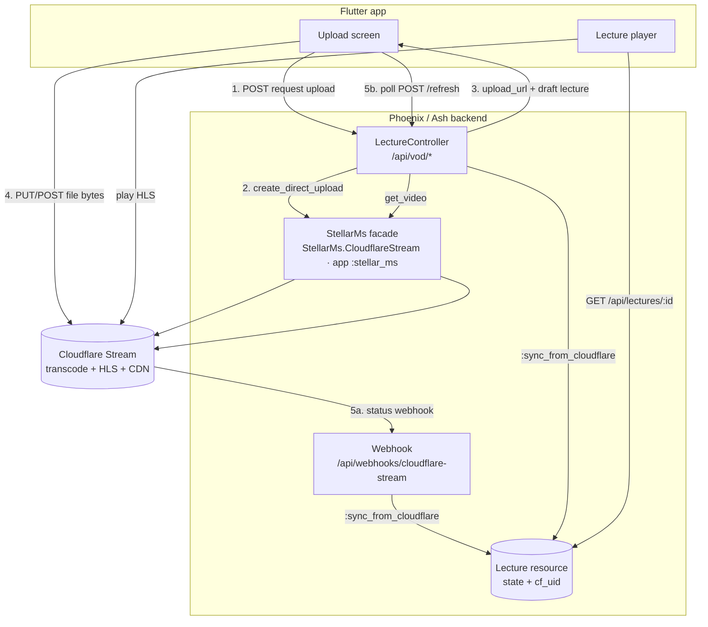
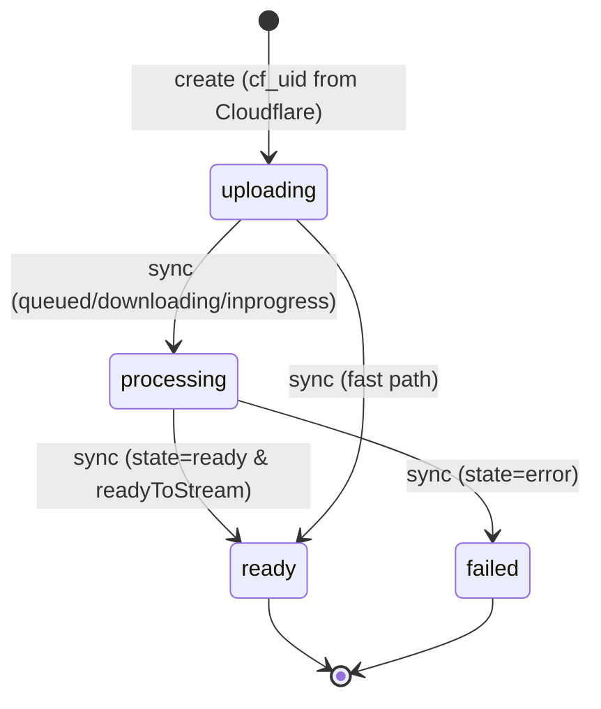
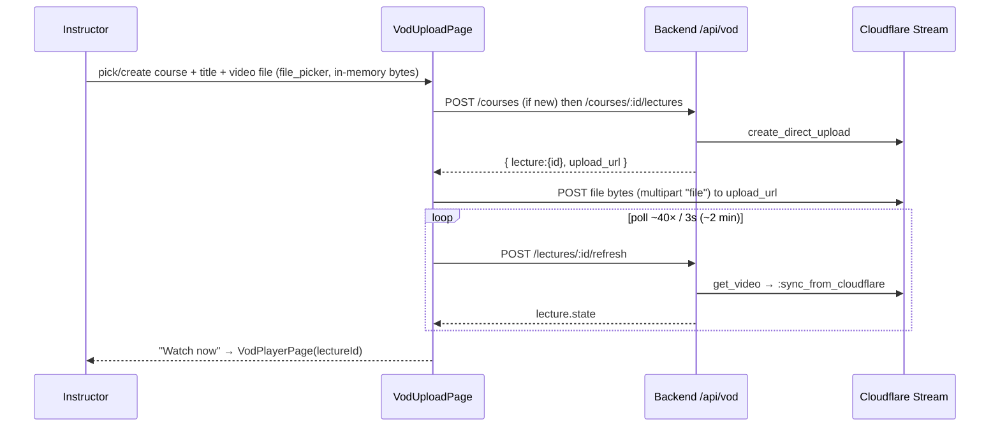

# Media Streaming (VOD) — Cloudflare Stream Integration

This document describes the **Video-on-Demand (VOD)** feature as it is
**implemented** on branch `feat/vod-media-streaming`: instructors upload a
lecture video, it is transcoded to HLS and served over a CDN by **Cloudflare
Stream**, and students play it back in an interactive, checkpoint-aware player
that works on both native platforms and the web. The forward-looking design
spec is [`04_media_streaming.md`](../04_media_streaming.md); the HTTP contract
is [`docs/api/vod.md`](../api/vod.md); this doc covers the integration end to end.

> [!TIP]
> VOD is a **reusable building block** for the upcoming course feature, not a
> standalone product. For how the next course update consumes these pieces
> (course-scoped uploads, the lecture viewer, enrollment gating, progress), see
> [`vod_in_courses.md`](./vod_in_courses.md).

> [!NOTE]
> The spec ([`04_media_streaming.md`](../04_media_streaming.md)) assumes a
> **self-hosted** media stack — Elixir Membrane pipelines, S3/CloudFront, an
> `ash_oban` transcode→transcribe→checkpoint job chain, and Whisper STT. That
> heavy infrastructure is **not** installed. This implementation replaces it
> with **Cloudflare Stream**, a managed *upload → transcode → HLS/DASH → CDN*
> service. The `ash_oban` stub pipeline was removed. **Out of scope:** live
> WebRTC capture / SFU, 1-on-1 consultation relay, and speech-to-text — the
> transcript stays empty and checkpoints are **time-based** (a chapter every
> 120s), not topic-detected.

---

## 1. Architecture at a glance

The video bytes **never pass through the Stellar backend** — the client uploads
directly to a one-time, pre-signed Cloudflare URL. The backend only mints that
URL, records lecture metadata, and learns when transcoding is done (via a
webhook *or* client polling).



---

## 2. Configuration

All Cloudflare credentials live in the gitignored `envs/.env` and are read at
runtime (`config/runtime.exs` → `config :stellar_ms, StellarMs.CloudflareStream`,
via Dotenvy `env!/3`; OS env wins). Nothing secret is committed.

| Env var | Config key | Purpose |
| :--- | :--- | :--- |
| `CLOUDFLARE_ACCOUNT_ID` | `account_id` | Cloudflare account for the Stream API |
| `CLOUDFLARE_STREAM_TOKEN` | `api_token` | API token, scope **Stream:Edit** (Bearer auth) |
| `CLOUDFLARE_STREAM_CUSTOMER_SUBDOMAIN` | `customer_subdomain` | Builds the HLS URL fallback (`https://<sub>/<uid>/manifest/video.m3u8`) |
| `CLOUDFLARE_STREAM_WEBHOOK_SECRET` | `webhook_secret` | Verifies the inbound status webhook (HMAC-SHA256) |
| `CLOUDFLARE_EMAIL` | `auth_email` | *Optional.* When set, auth switches to a **Global API Key** (`X-Auth-Email` + `X-Auth-Key`) instead of the Bearer token — for local testing only |
| `API_BASE_URL` *(FE `--dart-define`)* | — | Backend base URL the Flutter client calls (default `http://localhost:4000`) |

> [!IMPORTANT]
> `configured?/0` is true only when **both** `account_id` and `api_token` are
> non-empty. When it's false, the network calls short-circuit to
> `{:error, :not_configured}` (surfaced as **503** `video_service_not_configured`)
> and the seeder skips the demo video — so the app still boots and runs without
> Cloudflare credentials. Real uploads work once the token is filled.

---

## 3. Backend

### 3.1 Cloudflare Stream client — `StellarMs.CloudflareStream` (app `:stellar_ms`)

Media streaming lives in its own umbrella app, **`apps/stellar_ms`**. Callers use
the provider-agnostic **`StellarMs`** facade (`StellarMs.create_direct_upload/1`,
`get_video/1`, `upload_file/2`, `normalize/1`, `verify_webhook/2`, `hls_url_for/1`);
`apps/stellar_ms/lib/stellar_ms/cloudflare_stream.ex` is the provider client that
wraps the Cloudflare API (`https://api.cloudflare.com/client/v4`) with `Req`.

| Function | Purpose | Returns |
| :--- | :--- | :--- |
| `configured?/0` | Are `account_id` + `api_token` set? | `boolean` |
| `create_direct_upload/1` | Mint a single-use direct-creator upload URL (`:max_duration_seconds`, default 3600) | `{:ok, %{uid, upload_url}}` \| `{:error, _}` |
| `get_video/1` | Fetch + normalize a video's status | `{:ok, info}` \| `{:error, :not_found \| _}` |
| `upload_file/2` | Upload a **local** file to a signed `upload_url` (seeder only) | `:ok` \| `{:error, _}` |
| `normalize/1` | Map a Cloudflare payload (API **or** webhook — same shape) to the internal `info` map | `map` |
| `verify_webhook/2` | Constant-time HMAC-SHA256 check of the `Webhook-Signature` header | `boolean` |
| `hls_url_for/1` | Build the HLS manifest URL from the customer subdomain + uid | `String.t()` \| `nil` |

**Auth switch** (`req/0`): a non-empty `CLOUDFLARE_EMAIL` selects Global-API-Key
headers (`X-Auth-Email` + `X-Auth-Key = api_token`, for local testing);
otherwise the scoped `Bearer` token (default/production).

**`normalize/1` field mapping** (from Cloudflare → internal `info`):

| Internal key | Source | Notes |
| :--- | :--- | :--- |
| `uid` | `uid` | Cloudflare video id |
| `state` | `status.state` | `pendingupload \| queued \| downloading \| inprogress \| ready \| error` |
| `ready_to_stream` | `readyToStream == true` | strict boolean |
| `duration_seconds` | `duration` | coerced to a non-negative **integer** |
| `hls_url` | `playback.hls` **or** `hls_url_for(uid)` | falls back to the built URL |
| `dash_url` | `playback.dash` | |
| `thumbnail_url` | `thumbnail` | |
| `error_message` | `status.errorReasonText` | |

> [!NOTE]
> `upload_file/2` deliberately reads the whole file into memory
> (`File.read!`), not `File.stream!` — Cloudflare's upload endpoint drops a
> *streamed* multipart connection, whereas in-memory bytes are accepted (200).
> It uses `receive_timeout: 120_000, retry: :transient, max_retries: 3` and is
> intended for small files (≤200 MB, e.g. the seed sample) — **not** the
> primary upload path, which is client-direct (§4.2).

### 3.2 Lecture resource + lifecycle

`Stellar.Courses.Lecture` (`apps/stellar/lib/stellar/courses/lecture.ex`) models
one VOD unit. Migration `20260718021624_add_cloudflare_stream_lecture.exs` adds
`cf_uid` + `thumbnail_url` and changes the `state` default to `uploading` (the
`lectures` table and the other VOD columns come from the earlier
`20260716111437_add_courses_vod.exs`).

| Attribute | Type | Notes |
| :--- | :--- | :--- |
| `state` | atom | `[:uploading, :processing, :ready, :failed]`, default `:uploading` |
| `cf_uid` | string | Cloudflare video UID |
| `hls_url` | string | HLS manifest (set on `:ready`) |
| `thumbnail_url` | string | |
| `duration_seconds` | integer | |
| `format` | string | hard-coded `"hls (cloudflare)"` on `:ready` |
| `source_path` | string | legacy (unused for Cloudflare) |
| `error_message` | string | truncated to 500 chars |

Plus `title`, `description`, `position`, `course_id`; relationships
`belongs_to :course`, `has_many :video_checkpoints`, `has_one :transcript`.

**Actions:** `create` (accepts `title, description, position, course_id, cf_uid,
source_path`; sets `state: :uploading`), `sync_from_cloudflare` (arg `:info`,
`require_atomic? false`), `mark_failed`, plus default `read`/`destroy`.



**`SyncFromCloudflare`** (`courses/changes/sync_from_cloudflare.ex`) maps the
normalized `info` to a state and, on the **first** transition into `:ready`,
generates time-based checkpoints:

| `status.state` | `ready_to_stream` | Result |
| :--- | :--- | :--- |
| `"ready"` | `true` | `:ready` — set `hls_url`, `duration_seconds`, `format`, `thumbnail_url`; create checkpoints |
| `"ready"` | not `true` | `:processing` |
| `"error"` | — | `:failed` — set `error_message` |
| anything else | — | `:processing` |

- **Checkpoints:** one every `120s` starting at `0`, capped at `20`, titled
  `"Chapter N"`. A non-positive duration yields a single `"Chapter 1"` at `0`.
- **Idempotent:** the guard reads `changeset.data.state` (the *persisted*
  pre-update value), so repeated webhook/refresh/seed calls never create
  duplicate checkpoints — only the first `→ :ready` does.
- `fetch/2` accepts **both** atom keys (from `normalize/1`) and string keys
  (from raw webhook JSON), so the same change serves both callers.

### 3.3 HTTP API

Three controllers under `StellarWeb.Api`. Public reads sit in the plain `/api`
scope; writes sit in a Bearer-authed `/api/vod` sub-scope
(`pipe_through :api_auth` = `StellarWeb.Plugs.ApiAuth`). Full request/response
shapes are in [`docs/api/vod.md`](../api/vod.md).

| Method | Path | Auth | Purpose |
| :--- | :--- | :--- | :--- |
| `GET` | `/api/courses` | public | Course catalog (with `lecture_count`) |
| `GET` | `/api/courses/:id` | public | Course + its lectures |
| `GET` | `/api/lectures/:id` | public | Lecture detail + checkpoints + transcript |
| `POST` | `/api/vod/courses` | Bearer | Create a course (instructor = current user) |
| `POST` | `/api/vod/courses/:course_id/lectures` | Bearer | Mint upload URL + draft lecture |
| `POST` | `/api/vod/lectures/:id/refresh` | Bearer | Poll + sync processing status |
| `POST` | `/api/webhooks/cloudflare-stream` | signature | Cloudflare status callback |

> [!NOTE]
> All Ash reads/writes currently pass `authorize?: false` — even the Bearer
> writes bypass Ash policies, and the reads are public "for demo". The router
> notes: *produksi → pindahkan ke `:api_auth`* (move reads behind auth for
> production). There is **no ownership check** on who may upload beyond holding
> a valid Bearer token.

### 3.4 Webhook

`CloudflareStreamWebhookController.handle/2` authenticates by **signature**, not
user auth:

1. `StellarWeb.Plugs.CacheBodyReader` caches the **raw** request bytes into
   `conn.assigns.raw_body` for `/api/webhooks/cloudflare-stream` (needed because
   signature is computed over the raw body, not the parsed JSON).
2. `verify_webhook(raw, sig)` recomputes `HMAC-SHA256(secret, "<time>.<raw>")`
   and compares it constant-time against the `Webhook-Signature: time=…,sig1=…`
   header.
3. On success: decode JSON → `normalize/1` → find the `Lecture` by `cf_uid` →
   `:sync_from_cloudflare`. Responds **200** (empty body) — including when no
   lecture matches (`:ignore`). An invalid signature logs a warning and responds
   **400**.

### 3.5 Seeder + tests

**Seed** (`Stellar.Release.seed/0`, run via `bin/stellar eval Stellar.Release.seed`):
creates the course *"Introduction to Data Structures"* (idempotent by title). If
`StellarMs.configured?()`, it uploads `apps/stellar/priv/media/sample.mp4`
(~92 KB, git-tracked), creates the lecture *"Arrays, Lists & Big-O"*, then polls
`get_video → :sync_from_cloudflare` up to **45×2s ≈ 90s** until `:ready`/`:failed`.
If not configured (or the course already has a lecture), it skips the upload and
prints an activation hint. Re-running never re-uploads.

**Tests** (all passing) live with the code they cover. The media-streaming unit
tests are in **`apps/stellar_ms/test/stellar_ms_test.exs`**: `normalize/1` mapping,
`verify_webhook/2` (accepts a valid HMAC, rejects a bad/malformed one),
`hls_url_for/1`, and the `StellarMs` facade. The Lecture-sync test stays in
**`apps/stellar/test/stellar/courses/vod_sync_test.exs`**: `:sync_from_cloudflare`
state mapping (`ready → :ready` + 3 checkpoints for a 300s video at `[0,120,240]`;
`error → :failed`; `inprogress → :processing`).

---

## 4. Frontend

### 4.1 API client — `VodApi`

`apps/stellar_fe/lib/services/vod_api.dart` — a thin JSON client mirroring
`auth_api.dart`, with models `VodCourse`, `VodLecture` (getters `isReady` /
`isFailed` / `isProcessing`), `VideoCheckpoint`, `TranscriptSegment`,
`VodUploadTicket`, and `VodException` (UI-ready English messages).

| Method | Endpoint | Auth |
| :--- | :--- | :--- |
| `fetchCourses()` / `fetchCourse(id)` / `fetchLecture(id)` | `GET /api/courses[/:id]`, `/api/lectures/:id` | none |
| `createCourse(token, …)` | `POST /api/vod/courses` | Bearer |
| `requestUpload(token, …)` → `VodUploadTicket` | `POST /api/vod/courses/:id/lectures` | Bearer |
| `uploadToCloudflare(uploadUrl, bytes, …)` | the pre-signed URL (multipart field `file`) | **none** |
| `refreshLecture(token, id)` | `POST /api/vod/lectures/:id/refresh` | Bearer |

Backend `{error: <code>}` responses are mapped to friendly English
(`video_service_not_configured` → "Video uploads are not set up on the server
yet.", `cloudflare_error` → "The video service is unavailable right now…", etc.).

> [!IMPORTANT]
> VOD writes attach a **raw** `Authorization: Bearer <token>` (from
> `Session.instance.accessToken`) and are **not** wired to the app's
> refresh-on-401 path (`Session.runAuthed`). A 401 mid-upload surfaces as *"Your
> session has expired. Please sign in again."* with no automatic token
> rotation/retry — acceptable because the token is fresh and uploads are quick.

### 4.2 Upload flow — `VodUploadPage`

`apps/stellar_fe/lib/vod/vod_upload_page.dart` — a standalone library (its own
`file_picker` import), route `/vod/upload`, also reachable from an upload icon
(`Icons.file_upload_outlined`) in the player top bar. It is a `_Phase { form,
working, done, failed }` state machine gated behind a sign-in prompt.



The picked file is held in memory (`FilePicker.pickFiles(type: FileType.video,
withData: true)`). If polling hits the ~2-min cap while still transcoding, the
"done" card shows **"Still processing"** (not a failure) and *Watch now* still
deep-links to the player.

### 4.3 Playback — `VodPlayback` abstraction + hls.js on the web

The player module (`lib/vod/`) is a single interactive shell (dark 16:9 stage,
checkpoint seek-bar, Topics/Transcript tabs) that drives an abstract
**`VodPlayback`** (`lib/vod/player/vod_playback.dart`). One implementation is
picked at compile time by a conditional import:

```dart
import 'vod_playback_native.dart'
    if (dart.library.js_interop) 'vod_playback_web.dart' as impl;
```

| Target | Impl | Backing |
| :--- | :--- | :--- |
| iOS / Android / macOS / Safari | `_VideoPlayerPlayback` | `video_player` (native HLS) |
| Chrome / Firefox / Edge (web) | `_HlsWebPlayback` | HTML `<video>` + **hls.js** |

The web impl (`vod_playback_web.dart`) uses `dart:js_interop` / `dart:ui_web` /
`package:web`: it creates a `<video>`, registers it as a platform view
(`HtmlElementView` + `platformViewRegistry.registerViewFactory`), attaches
**hls.js** (`Hls.isSupported()` → `loadSource` + `attachMedia`; falling back to a
native `src` when `canPlayType('application/vnd.apple.mpegurl')`), and bridges
DOM media events (`loadedmetadata`, `timeupdate`, `waiting`, `playing`, `error`,
…) into the shell's listener so the seek-bar, checkpoints and transcript stay
synced. **hls.js is bundled locally** at `web/hls.min.js` (~415 KB) and loaded by
a synchronous `<script>` in `web/index.html` *before* the Flutter bootstrap so
`window.Hls` exists at boot.

> [!NOTE]
> This **supersedes the old caveat** that HLS "can't play on Chrome/Firefox".
> With hls.js those browsers now play the Cloudflare stream; Safari/native use
> the platform decoder. If a stream genuinely can't load, `_VideoStage` shows a
> graceful overlay and the topics/transcript still work (the timeline falls back
> to the backend `duration_seconds`).

---

## 5. Running locally

```bash
# 1. Fill envs/.env (gitignored) with a Stream-enabled account:
#    CLOUDFLARE_ACCOUNT_ID, CLOUDFLARE_STREAM_TOKEN (Stream:Edit),
#    CLOUDFLARE_STREAM_CUSTOMER_SUBDOMAIN  (+ optional _WEBHOOK_SECRET / _EMAIL)

# 2. Database + backend (umbrella root)
mix ecto.create && mix ecto.migrate
mix phx.server                                   # http://localhost:4000

# 3. Seed the demo course + sample lecture (uploads to Cloudflare, polls to ready)
bin/stellar eval Stellar.Release.seed            # or the bin/seed script

# 4. Frontend
cd apps/stellar_fe
flutter run -d chrome --web-port=8081 \
  --dart-define=API_BASE_URL=http://localhost:4000
```

Then sign in, open `/vod`, tap the **upload** icon (or go to `/vod/upload`),
pick a small `.mp4`, wait for **ready**, and hit **Watch now**.

New Flutter deps: `file_picker 11.0.0` (pinned), `http_parser ^4.1.2`,
`web ^1.1.1` (alongside the existing `video_player ^2.9.2`).

---

## 6. Known limitations / deferred

- **No speech-to-text.** The transcript is always empty; checkpoints are
  **time-based** (a chapter every 120s, ≤20), not topic-detected. The
  `Transcript` relationship exists but is never populated.
- **Public reads / no ownership checks.** All Ash calls use `authorize?: false`;
  reads are public and any Bearer holder can upload. Move reads behind
  `:api_auth` and add instructor/ownership authorization before production.
- **VOD writes bypass refresh-on-401** (see §4.1) — no automatic token rotation.
- **Webhook secret is optional locally.** Without `CLOUDFLARE_STREAM_WEBHOOK_SECRET`,
  `verify_webhook/2` returns false → 400, so status updates rely on the client
  `/refresh` polling path instead of the push webhook.
- **`cf_uid == ""` edge case:** `/refresh` maps only a `nil` `cf_uid` to `422
  no_cf_uid`; an empty-string `cf_uid` falls through to `502 cloudflare_error`.
- **Live capture out of scope.** The spec's WebRTC SFU classroom stream and 1-on-1
  consultation relay are not implemented — this is upload-based VOD only.
- **Runtime web playback needs a browser smoke test.** The build compiles
  cleanly (`flutter build web`), but actual hls.js playback can't be verified
  headlessly — confirm once in Chrome.
