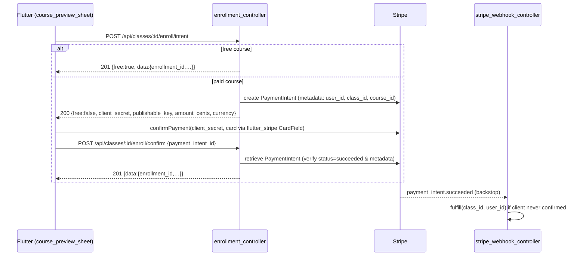
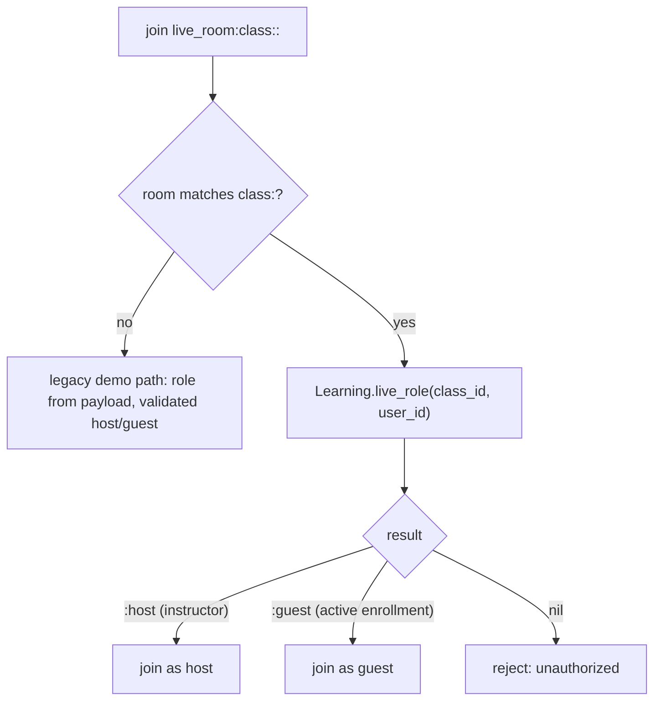
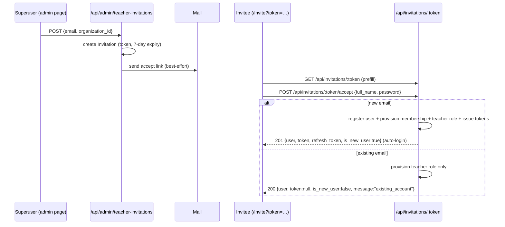

# Starting User Flow After Onboarding — implementation notes

**Branch:** `77-starting-user-flow-after-onboarding` · **Status:** working-tree changes,
**not committed** · **Scope:** backend (`stellar`, `stellar_lrn`, `stellar_ms`,
`stellar_web`) + Flutter frontend (`stellar_fe`) + config.

This document records the changes made on this branch. The theme is **what a user
does once onboarding is finished**: where each role lands, and the first real
actions they can take against the backend. Up to now the post-onboarding surfaces
(Explore catalog, live sessions, teacher tools) were UI-only or demo-wired; this
branch connects them to real data and adds the missing entry points.

Five threads make up the change:

| # | Thread | One-line |
| :--- | :--- | :--- |
| 1 | **Role-adaptive landing** | After login, `_homeFor(session)` routes superuser → invitations admin, teacher → teacher workspace, org → dashboard/pending, else onboarding → dashboard. |
| 2 | **Real course catalog** | Explore is wired to `GET /api/catalog/courses`; `Course` gains `is_public` + `price_cents`/`currency`; all unbacked filters/badges removed; a sample-catalog seeder added. |
| 3 | **Enrollment (free + Stripe paid)** | Free courses enrol in one call; paid courses go through a Stripe PaymentIntent (`/enroll/intent` → card sheet → `/enroll/confirm`), with a webhook backstop. |
| 4 | **Live sessions gated by enrollment** | WebRTC rooms `class:<id>:<mode>` derive the caller's role on the server (instructor → host, active-enrolled → guest, else reject). |
| 5 | **Teacher invitation flow + object storage** | Superuser invites teachers by email → token accept page provisions a teacher account/role → teacher dashboard uploads docs (video via Cloudflare Stream, pdf/doc via new S3/MinIO storage). |

> [!NOTE]
> Per the branch memory these changes were exercised end-to-end (Docker + Playwright,
> Stripe test card) during development but **no verification was run while writing
> this doc** — it is a description of the diff, not a fresh test report. The changes
> are uncommitted. See [§10 Verification & housekeeping](#10-verification--housekeeping).

---

## 1. Role-adaptive landing (the "starting" seam)

`apps/stellar_fe/lib/main.dart` was reworked around a single `_homeFor(session)`
resolver, and every auth response now carries the user's system role keys so the
client can branch on them.

```
superuser (is_superuser)     → TeacherInvitationsPage   (lib/admin/)
teacher   (roles.teacher)    → TeacherDashboardPage      (lib/teacher/)
org account, approved        → DashboardPage
org account, not approved    → OrgPendingPage
otherwise                    → onboarding → DashboardPage
```

- **Roles on every auth response.** `StellarWeb.Api.UserSerializer.to_json/1`
  (new, `apps/stellar_web/lib/stellar_web/controllers/api/user_serializer.ex`) is now
  the single user-JSON shape for login / register / refresh / google / invitation-accept.
  It adds `roles: Stellar.Authz.role_keys(user)` and `approved`. `auth_controller.ex`
  dropped its local `user_json/1` + `approved?/1` and delegates here.
- **`Stellar.Authz.role_keys/1`** (new) returns the distinct **system** role keys
  across the user's *active* memberships (org-agnostic), e.g. `["teacher"]`.
- **Flutter `AuthUser`** gained `List<String> roles` + `bool get isTeacher =>
  roles.contains('teacher')` (`services/auth_api.dart`).
- **Public deep link.** `main.dart` matches `Uri.path == '/invite'` **before** the
  named-route table so `/invite?token=…` is reachable signed-in or signed-out. A
  `_needsSuperuser` guard bounces non-superusers off `/admin/*` back through `_homeFor`.

---

## 2. Real course catalog

The Flutter Explore module was converted from a hard-coded, UI-only catalog into a
live one, and the `Course` resource gained the two fields the catalog needs
(visibility + price).

### 2.1 Backend

`apps/stellar_web/lib/stellar_web/controllers/api/catalog_controller.ex`:

- **Visibility rule** (both `index/2` and `show/2`): a course is returned when
  `is_active == true AND (is_public == true OR organizations.id in org_ids)`.
  `is_public` lets an **org-less individual learner** browse a course.
- **Class scoping is now conditional.** A public course's detail loads **all** its
  classes; an org-scoped course loads only classes in the caller's orgs.
- `course_summary_json/1` dropped its `org_ids` argument; `class_count` is now
  `Enum.count(course.classes)` (no longer filtered to the caller's org).
- Both summary and detail JSON now emit `price_cents`, `currency`, and `is_free`
  (`is_free = is_nil(price_cents) or price_cents <= 0`).

Org scope comes from `StellarWeb.Api.StudentScope.org_ids/1` (organizations where a
`Membership` is `status == :active`). Catalog reads use `Ash.read!(authorize?: false)`
and rely on this manual scope + the `is_public`/`is_active` filter (not Ash policies).

### 2.2 `Course` resource + migrations

`apps/stellar_lrn/lib/stellar_lrn/learning/course.ex` — three new attributes, all
added to `default_accept`:

| Attribute | Type | Notes |
| :--- | :--- | :--- |
| `is_public` | `:boolean` | `allow_nil?: false`, default `false` |
| `price_cents` | `:integer` | nullable; `nil` or `<= 0` ⇒ **free** |
| `currency` | `:string` | `allow_nil?: false`, default `"usd"` |

Migrations (+ resource snapshots):
`20260726101500_add_course_is_public.exs`, `20260726160000_add_course_price.exs`.

> [!NOTE]
> The price migration declares `price_cents` as `:bigint` while the Ash attribute /
> snapshot say `:integer`. This is **consistent** — Ash's `:integer` maps to Postgres
> `bigint` — but worth knowing if you read the raw column type.

### 2.3 What was deleted from Explore (and why)

The backend `Course` only stores title / description / section / industries /
class-count / price. So every **fabricated facet or badge** the UI could not back was
removed. Remaining filtering (industry-by-name + free-text search) and sorting
(A–Z / Z–A / most classes) run **client-side** over the fetched list.

**Deleted part files (8):**
`shell/active_chips.dart`, `shell/filter_sheet.dart`, `shell/skills_check_band.dart`,
`shell/skills_check_sheet.dart`, `widgets/filters_button.dart`,
`widgets/removable_chip.dart`, `widgets/segmented.dart`, `widgets/select_chip.dart` —
i.e. the delivery-mode / level / duration filter machinery and the skills-check promo.

**Rewritten:** `explore_shell.dart` is now a fetch-once orchestrator
(`Session.instance.runAuthed(_api.listCourses)`) with loading (skeleton) → error
(retry) → empty-catalog → no-match → grid states. `models.dart` dropped the
`Industry`/`Level`/`DeliveryMode`/`_Duration` enums; `_Course` is backed 1:1 by
`CourseSummary`. `data.dart` resolves an industry's visual (icon/label/theme) from the
backend industry **name** with a deterministic hash fallback for unknown names.
`course_card.dart` shows an industry chip, a **Free / price** pill, description, and a
class-count row (height 388 → 356; `skeleton_card.dart` matched). `course_grid.dart`
re-keyed its local saved/bookmark set from course **title → id**.

### 2.4 Sample-catalog seeder

`apps/stellar_lrn/lib/stellar_lrn/seeds.ex` (new) — `StellarLrn.Seeds.seed/0` is an
**idempotent** seeder that populates 4 sections and 8 courses (1 class each) into the
org named **"Atveti"**, links `Section/Course/Industry` join rows via upsert, and makes
the Atveti owner (the seeded superuser) an active member so the seeded courses are
visible. All seeded courses are `is_public: true`; two carry a price (`4900`, `9900`).
It no-ops (returns 0) if the "Atveti" org doesn't exist yet.

It is dispatched from `Stellar.Release.seed/0` via **runtime `apply/3`**
(`Code.ensure_loaded?` + `function_exported?`), guarded by `rescue`, so that:
(a) `:stellar` never references `:stellar_lrn` at compile time — which would form an
umbrella dependency cycle (see `CLAUDE.md`); and (b) a catalog-seed failure never
aborts the critical superuser/RBAC/master-data seed.

---

## 3. Enrollment — free and Stripe paid

Class enrolment branches on the course price. The FE mirrors the backend predicate
`paid?(course) = price_cents != nil and price_cents > 0`.



### 3.1 Backend

- **`enrollment_controller.ex`** — `create/2` (`POST …/enroll`) now enrols **free
  courses only** and returns `402 payment_required` (with `amount_cents`/`currency`)
  for paid. New `create_intent/2` and `confirm/2` implement the paid flow.
  `confirm/2` **re-retrieves the PaymentIntent server-side** and rejects unless
  `status == "succeeded"` **and** `metadata.user_id == caller` **and**
  `metadata.class_id == path id` — the client's success signal is not trusted alone.
  `visible_class/2` was widened so enrolment is allowed for a public+active course
  (not just org-member classes).
- **`StellarWeb.Enrollments.fulfill/2`** (new,
  `apps/stellar_web/lib/stellar_web/enrollments.ex`) — the single **idempotent**
  enrolment-creation seam. Returns the existing `Enrollment` for a (class, student)
  pair or creates one. It lives in `stellar_web` (which depends on both `stellar_lrn`
  and `stellar`) so payments can trigger an enrolment without an umbrella cycle.
- **`stripe_webhook_controller.ex`** — on a verified `payment_intent.succeeded`
  event whose metadata carries `class_id` + `user_id`, calls the same
  `Enrollments.fulfill/2` as a best-effort backstop (rescue-logged; never fails the
  200 ack).
- **`payments/billing.ex`** — `create_payment_intent/2` now merges caller metadata
  (`user_id` + `class_id`/`course_id`); new `get_payment_intent/1`; `handle_webhook`
  returns the verified event. `ensure_customer/1` now does `to_string(email)` because
  an `Ash.CiString` breaks the Stripe form encoder (a real fix).
- **`payments/stripe/client.ex`** — new `retrieve_payment_intent/1`.

> [!IMPORTANT]
> **Three-tier fulfilment, one idempotent path.** Both the synchronous `/enroll/confirm`
> and the webhook route through `StellarWeb.Enrollments.fulfill/2`, so a double-call
> returns the existing enrolment rather than erroring. The Stripe client explicitly
> disables Req auto-retry on `POST /v1/payment_intents` to avoid double charges.

### 3.2 Frontend

- `services/courses_api.dart` (new) — `startEnroll` / `confirmEnroll` / `enroll` /
  `unenroll` / `listCourses` / `getCourse` / `listEnrollments`; maps backend error
  codes (`already_enrolled`, `full`, `payment_required`, `payment_mismatch`, …) to
  UI English; `401 → AuthException` so `Session.runAuthed` rotates the refresh token
  and retries.
- `explore/shell/course_preview_sheet.dart` — the enrol UX. `_enroll` calls
  `startEnroll`; if `free` it marks enrolled, else `_payWithCard` sets
  `Stripe.publishableKey` **at runtime** (delivered in the intent response — no key
  baked into the app) and opens `_CardPaymentSheet` (`flutter_stripe` `CardField` +
  `Stripe.instance.confirmPayment`), then `confirmEnroll`. Button label:
  `Enrol` or `Enrol · <priceLabel>`.
- **Deps:** `flutter_stripe: ^11.5.0`, `flutter_stripe_web: ^6.5.0`
  (`pubspec.yaml`; web card entry via Stripe Elements/iframe on the CanvasKit build).

---

## 4. Live sessions gated by enrollment

WebRTC rooms are now enrollment-gated at the signalling channel. A room id of the form
`class:<class_id>:<mode>` is recognised by `LiveRoomChannel.join`, which **derives the
role on the server** and ignores any client-supplied role.



- **`StellarLrn.Learning.live_role/2`** (new) → `:host` if the caller is the class
  `instructor_id`, else `:guest` if `enrolled?/2`, else `nil`. Wrapped in `rescue` so a
  malformed (non-UUID) class id maps to `nil` rather than crashing the join.
- **`enrolled?/2`** counts **only** `status == :active` — a `:completed` enrollment
  does **not** grant guest access to the room.
- **`live_room_channel.ex`** — `resolve_role/3` parses the class id from the room
  (`class_id_from_room/1`) and calls `live_role`; `nil → {:error, %{reason:
  "unauthorized"}}`. Non-`class:` rooms keep the old payload-role behaviour for demo
  compatibility.

> [!NOTE]
> The `:<mode>` suffix in the room id is parsed **away** server-side; the effective
> mode still comes from the separate `params["mode"]`. Consequence: each mode is a
> distinct room (`class:<id>:classroom` vs `class:<id>:one_on_one`), so teacher and
> student must pick the **same** mode to meet — which the shared Flutter helper
> `classRoomId(classId, mode)` (`live/data/live_models.dart`) enforces.

### 4.1 Pickers (both sides)

- **Teacher:** `GET /api/me/classes` (new `class_controller.ex`) lists classes where
  `instructor_id == current_user.id`. `TeacherDashboardPage` (and the teacher live
  section) auto-selects a single class or opens a "Choose a class" sheet, then joins
  as `host`.
- **Student:** `GET /api/me/enrollments` (extended with `class.schedule`) drives the
  new `_EnrolledClassesCard` (`dashboard/widgets/enrolled_classes_card.dart`), which
  replaced the old hard-coded demo card in `live_coaching_screen.dart`. Each row has
  Classroom / 1-on-1 / Conference join buttons and joins as `guest` (the server
  derives the real role regardless).
- `dashboard/screens/my_courses_screen.dart` became stateful and self-fetches
  `GET /api/me/enrollments` via `CoursesApi.listEnrollments`.

Domain test: `apps/stellar_lrn/test/stellar_lrn/learning/live_gate_test.exs` covers
`live_role/2` and `enrolled?/2`. **Gap:** there is no channel-level test for the
`class:<id>` reject path (the existing channel test only exercises the legacy free-room
path).

---

## 5. Teacher invitation flow + object storage

A superuser invites people to teach by email; the invitee accepts via a public
token-gated page that provisions a teacher account/role; the teacher then uploads
content.



### 5.1 Invitation domain

`apps/stellar/lib/stellar/invitations/` (new `Stellar.Invitations` Ash domain):

- **`Invitation`** resource (table `invitations`, migration
  `20260725143443_create_invitations.exs`): `email` (`:ci_string`), `role_key`
  (default `"teacher"`), `token` (`sensitive?: true`), `status`
  (`:pending`/`:accepted`/`:revoked`), `expires_at` (now + 7 days),
  `accepted_at`, `last_sent_at`, `resend_count`, `invited_by_id` / `accepted_user_id`
  (loose `:uuid` audit — **not FKs**, so history survives user deletion),
  `belongs_to :organization` (the only real FK). Identity `:unique_token`.
  Actions: `create` (token = 32 random bytes url-encoded), `resend`, `accept`, `revoke`.
- **`Service`** — orchestration: `invite/1` (reuses+resends an existing *pending*
  invite for the same email+org instead of duplicating), `get_by_token/1`, `accept/2`
  (new email → register + force-complete onboarding + provision + auto-login;
  existing email → provision role only, **no** auto-login). All provisioning runs in a
  `Stellar.Repo.transaction`.
- **`Email`** — Swoosh builder; the accept link is a **hash route**
  `<fe_base_url>/#/invite?token=…` (the Flutter web build reads routes from the URL
  fragment). Delivery is best-effort (logs the URL, never raises).

> [!IMPORTANT]
> **Security notes.** (1) The `token` is stored **raw** (only `sensitive?: true`, no
> hash column) and matched by equality. (2) The `Invitation` resource is
> `authorize?: false` — all access control is at the web layer (superuser plug for
> admin routes; the public accept routes are intentionally token-gated with no login).
> (3) An existing account is **not** auto-logged-in on accept (avoids a password
> bypass); the client routes it to normal login.

### 5.2 RBAC catalog refactor

To share one role/permission definition between the release seeder and per-invite
provisioning, the catalog was **extracted out of `Stellar.Release`**:

- **`Stellar.Rbac.Catalog`** (new) — single source of truth for `@permissions` and
  `@roles`. In the move, the **`teacher` role gained `documents:read` +
  `documents:manage`**.
- **`Stellar.Rbac.Provisioning`** (new) — idempotent `ensure_permissions!/0` and
  `ensure_org_role!/2` (upserts a per-org system `Role` + its `RolePermission` links).
  System roles are **per-organization**, so accepting an invite lazily creates the
  `teacher` role in the superuser-chosen org if it doesn't exist yet.
- `Stellar.Release` now delegates `seed_rbac/1` to `Provisioning`, and seeds the
  superuser via `:register_with_email` + `SEED_SUPERUSER_PASSWORD` (default
  `superuser123`) so it can log into the Flutter app and land on the invitations admin.

### 5.3 Web layer

- `plugs/require_superuser_api.ex` (new) — passes only when `current_user.is_superuser`,
  else `403 {error: "forbidden"}`.
- `controllers/api/admin/invitation_controller.ex` + `organization_controller.ex`
  (new, superuser) — list/create/resend invitations; list orgs for the invite dropdown.
- `controllers/api/invitation_controller.ex` (new, **public**) — token show + accept.

Tests: `Stellar.Invitations.ServiceTest`,
`StellarWeb.Api.InvitationControllerTest` (admin 201 / non-superuser 403 / no-token 401;
public show + accept), `StellarWeb.Api.DocumentUploadTest`, `StellarMs.S3StorageTest`.

### 5.4 Object storage (S3 / MinIO) for non-video docs

Teachers upload **video** via the existing Cloudflare Stream path, and **pdf/doc**
via a new S3-compatible facade:

- **`StellarMs.Storage`** (new) — provider-agnostic facade, kept separate from the
  `StellarMs` video facade and `StellarMs.Realtime` so their `configured?/0` don't
  collide. Delegates to `StellarMs.S3Storage`.
- **`StellarMs.S3Storage`** (new) — presigned **PUT** URLs for R2 / S3 / MinIO.
  Signs `AWS4-HMAC-SHA256` query-string URLs **locally via `:crypto`** — no AWS SDK,
  no network call — keeping `stellar_ms` a leaf app. Config under the `:stellar_ms`
  otp_app key.
- `document_controller.ex` — new `create_upload/2` (`POST /api/documents/upload-url`,
  mints the presigned URL) and `create/2` (`POST /api/documents`, persists a standalone
  `StellarDoc.Documents.Document` with `course_id: nil`). Both require the caller to
  belong to an org (`Authz.active_org_id`).
- FE: `services/documents_api.dart` gained `requestUploadUrl` / `uploadBytes` (raw PUT
  to the presigned URL) / `createDocument`; `teacher/upload_document_page.dart` (new)
  handles both media kinds; `teacher/teacher_dashboard_page.dart` (new) lists docs +
  starts live sessions.

---

## 6. New / changed HTTP API surface

All routes are in `apps/stellar_web/lib/stellar_web/router.ex`. New pipeline
`:require_superuser_api`.

| Method | Path | Auth (pipeline) | Purpose |
| :--- | :--- | :--- | :--- |
| `GET` | `/api/catalog/courses` | Bearer (`:api_auth`) | Catalog list: active courses that are public **or** shared to the caller's org (unchanged route; response gained `price_cents`/`currency`/`is_free`) |
| `GET` | `/api/catalog/courses/:id` | Bearer | Course detail + classes + materials |
| `POST` | `/api/classes/:id/enroll` | Bearer | Free-only enrol (paid → `402 payment_required`) |
| `POST` | `/api/classes/:id/enroll/intent` | Bearer | Start enrol: free ⇒ enrol now, paid ⇒ Stripe PaymentIntent |
| `POST` | `/api/classes/:id/enroll/confirm` | Bearer | Verify succeeded PaymentIntent server-side, then grant enrol |
| `DELETE` | `/api/classes/:id/enroll` | Bearer | Leave a class |
| `GET` | `/api/me/enrollments` | Bearer | Caller's enrollments (now includes `class.schedule`) — student join / My Courses |
| `GET` | `/api/me/classes` | Bearer | **New:** classes the caller instructs — teacher live-session picker |
| `POST` | `/api/webhooks/stripe` | Signature | Stripe webhook; backstop-fulfils enrol on `payment_intent.succeeded` |
| `POST` | `/api/documents/upload-url` | Bearer | **New:** presigned PUT URL for a non-video doc |
| `POST` | `/api/documents` | Bearer | **New:** persist a standalone Document after upload |
| `GET` | `/api/invitations/:token` | **Public** (`:api`) | **New:** fetch invitation by token (prefill accept page) |
| `POST` | `/api/invitations/:token/accept` | **Public** | **New:** accept invite → create/link teacher account |
| `GET` | `/api/admin/teacher-invitations` | Superuser | **New:** list invitations |
| `POST` | `/api/admin/teacher-invitations` | Superuser | **New:** invite a teacher `{email, organization_id, role_key?}` |
| `POST` | `/api/admin/teacher-invitations/:id/resend` | Superuser | **New:** resend (extends expiry, bumps count) |
| `GET` | `/api/admin/organizations` | Superuser | **New:** org list for the invite dropdown |

Superuser pipeline = `[:api, :api_auth, :require_superuser_api]`.

---

## 7. Data model & migrations

| Table / resource | Change | Migration |
| :--- | :--- | :--- |
| `courses` | `+ is_public boolean NOT NULL default false` | `20260726101500_add_course_is_public.exs` |
| `courses` | `+ price_cents bigint NULL`, `+ currency text NOT NULL default 'usd'` | `20260726160000_add_course_price.exs` |
| `invitations` | **New table** (email, role_key, token, status, expires_at, audit uuids, `organization_id` FK) | `20260725143443_create_invitations.exs` |

Resource snapshots added under `apps/stellar/priv/resource_snapshots/repo/` for
`courses/` (both migrations) and `invitations/`. No schema change to `Enrollment`,
`Membership`, `MembershipRole`, `Payment`, or `Document` — those are reused as-is.

---

## 8. Configuration & new env vars

`config/config.exs`:

- `Stellar.Invitations` added to `ash_domains` for **both** `:stellar` and `:stellar_web`.
- `config :stellar, :mail_from, {"Stellar", "no-reply@stellar.local"}`.
- `config :stellar, :fe_base_url, "http://localhost:8081"` (used to build invite links).

`config/runtime.exs`:

- `FE_BASE_URL` overrides `:stellar, :fe_base_url`.
- New `config :stellar_ms, StellarMs.S3Storage` block (all optional; unset ⇒
  `configured?/0` is `false` and real doc uploads are skipped).

| Env var | Consumed by | Default |
| :--- | :--- | :--- |
| `FE_BASE_URL` | invite accept link | `http://localhost:8081` |
| `S3_ENDPOINT` | `StellarMs.S3Storage` | — |
| `S3_REGION` | `StellarMs.S3Storage` | `auto` |
| `S3_BUCKET` | `StellarMs.S3Storage` | — |
| `S3_ACCESS_KEY_ID` | `StellarMs.S3Storage` | — |
| `S3_SECRET_ACCESS_KEY` | `StellarMs.S3Storage` | — |
| `S3_PUBLIC_BASE_URL` | `StellarMs.S3Storage` | — |
| `SEED_SUPERUSER_PASSWORD` | release seeder | `superuser123` |

> [!NOTE]
> The `STRIPE_*` env vars (`STRIPE_SECRET_KEY`, `STRIPE_PUBLISHABLE_KEY`,
> `STRIPE_WEBHOOK_SECRET`, `STRIPE_API_BASE`) are **pre-existing** (payments gateway
> branch) and are only *consumed* here — this branch did not add them.

Other: `apps/stellar_fe/Dockerfile` adds `--pwa-strategy=none` to `flutter build web`
so a browser refresh always loads the latest bundle; the admin course form
(`admin/course_html.ex`) gained an `is_public` checkbox.

---

## 9. File inventory

**New backend files:**
`invitations.ex` + `invitations/{invitation,service,email}.ex`, `rbac/catalog.ex`,
`rbac/provisioning.ex`, `stellar_lrn/seeds.ex`, `stellar_ms/{storage,s3_storage}.ex`,
`stellar_web/enrollments.ex`, `plugs/require_superuser_api.ex`,
`controllers/api/{class_controller,invitation_controller,user_serializer}.ex`,
`controllers/api/admin/{invitation_controller,organization_controller}.ex`,
3 migrations + 3 snapshots, 5 test files.

**New frontend files:**
`admin/teacher_invitations_page.dart`, `invite/invite_accept_page.dart`,
`teacher/{teacher_dashboard_page,upload_document_page}.dart`,
`dashboard/widgets/enrolled_classes_card.dart`,
`services/{classes_api,courses_api,invitations_api}.dart`.

**Deleted frontend files (8):** the Explore filter/skills-check parts listed in §2.3.

**Modified (key):** `catalog_controller.ex`, `enrollment_controller.ex`,
`stripe_webhook_controller.ex`, `document_controller.ex`, `auth_controller.ex`,
`router.ex`, `payments/{billing,stripe/client}.ex`, `authz.ex`, `release.ex`,
`learning.ex`, `learning/course.ex`, `live_room_channel.ex`, `config/{config,runtime}.exs`,
`main.dart`, `auth_api.dart`, `session.dart`, `documents_api.dart`, and the rewritten
Explore + dashboard Dart parts.

---

## 10. Verification & housekeeping

- **Tests present** (not run while writing this doc): `Stellar.Invitations.ServiceTest`,
  `StellarLrn.Learning.LiveGateTest`, `StellarWeb.Api.InvitationControllerTest`,
  `StellarWeb.Api.DocumentUploadTest`, `StellarMs.S3StorageTest`.
- **Known test gaps:** no seeder test; no channel-level test for the `class:<id>` live
  gate (covered only at the domain layer).
- **Not committed** — everything above is uncommitted working-tree changes.

> [!WARNING]
> **Delete `mr.json` before committing.** There is an untracked `mr.json` at the repo
> root whose entire content is an API error blob
> (`{"error":"insufficient_scope",…}`) — the accidental output of a failed merge-request
> call. It is not a feature change; add it to `.gitignore` / remove it, and do **not**
> commit it.

---

**See also:**
[`users_and_roles.md`](./users_and_roles.md) ·
[`vod_in_courses.md`](./vod_in_courses.md) ·
[`media_streaming_vod_integration.md`](./media_streaming_vod_integration.md) ·
[`live_streaming_webrtc.md`](./live_streaming_webrtc.md) ·
[`../03_course_management.md`](../03_course_management.md) ·
[`../api/learning.md`](../api/learning.md)
