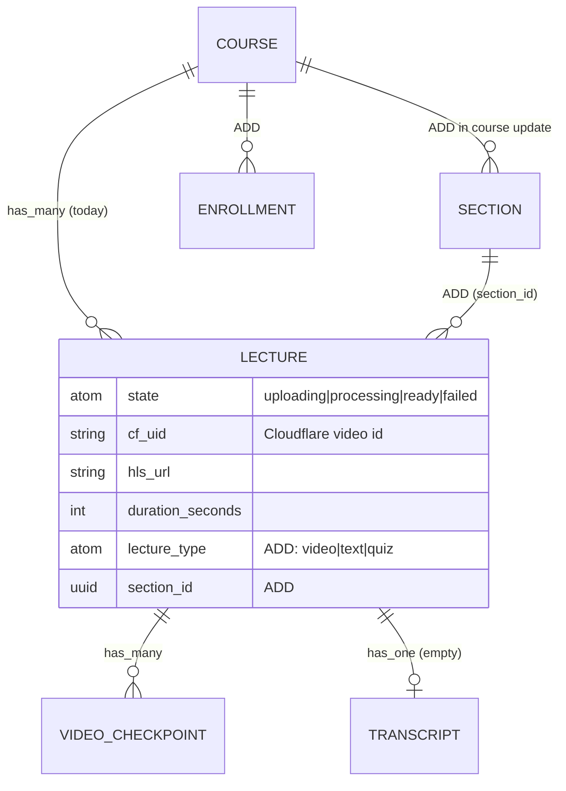

# Using VOD in Courses — integration guide for the upcoming course update

VOD (Cloudflare Stream) was built as a **standalone, reusable building block**.
It is not a finished course experience — it is the *video* layer that the next
**course update** will consume. This guide explains **how** the course feature
plugs into the existing VOD pieces: what to reuse as-is, how the current model
maps onto the planned course schema in
[`03_course_management.md`](../03_course_management.md), and the adaptation work
the course update needs to do.

> [!NOTE]
> The VOD layer is **implemented and verified** — see
> [`media_streaming_vod_integration.md`](./media_streaming_vod_integration.md)
> (implementation) and [`api/vod.md`](../api/vod.md) (HTTP contract). Nothing in
> this guide changes VOD; it is a **consumption** guide for the course feature.
> Treat the VOD upload/transcode/playback path as done — don't rebuild it.

---

## 1. What VOD already gives the course feature (reuse as-is)

| Building block | Where | Reuse for courses |
| :--- | :--- | :--- |
| `Course` + `Lecture` Ash resources | `apps/josjob/lib/josjob/courses/` | The course model's spine already exists (`Course has_many :lectures`) |
| Managed upload → transcode → HLS | `JosjobMs.CloudflareStream` (app `:josjob_ms`) | Instructors add video lectures without any self-hosted media infra |
| VOD HTTP API | `/api/courses`, `/api/lectures/:id`, `/api/vod/*` | Course screens read these; the course-builder posts to `/api/vod/*` |
| Interactive cross-platform player | `lib/vod/` → `VodPlayerPage` | The course "Lecture Viewer" video panel — plays HLS on web (hls.js) + native |
| Time-based checkpoints | `SyncFromCloudflare` → `video_checkpoints` | The seek-bar chapters / "topics" panel in the lecture viewer |
| Flutter API client + upload screen | `services/vod_api.dart`, `vod/vod_upload_page.dart` | Course catalog fetch + the instructor "add a video lecture" flow |

The upload endpoint is **already course-scoped**:
`POST /api/vod/courses/:course_id/lectures` — so a course-builder just passes the
real `course_id` instead of creating a throwaway course.

---

## 2. Current model vs the planned course schema

The planned schema ([`03_course_management.md`](../03_course_management.md)) is
richer than what VOD needed. Here's the mapping and the gaps the course update
fills:

| Planned (spec §1) | Today (VOD) | Gap to close in the course update |
| :--- | :--- | :--- |
| `COURSES.is_published` | `Course` has `title, description, instructor_id, industry_id` | Add `is_published` (+ visibility) for the guest catalog |
| `SECTIONS` (course → sections) | **none** — `Lecture belongs_to :course` directly | Add a `Section` resource; give `Lecture` a `section_id` |
| `LECTURES.lecture_type` (`video`/`text`/`quiz`) | Lecture is implicitly a **video** | Add `lecture_type`; a `:video` lecture carries the Cloudflare fields |
| `LECTURES.content_url` ("Membrane VOD / File URL") | `hls_url` (Cloudflare HLS) | The spec's `content_url` **is** `hls_url` now — no Membrane |
| checkpoints `{time_seconds, topic}` | `video_checkpoints {start_seconds, title}` | Naming differs; the API already returns `start_seconds`/`title` |
| `ENROLLMENTS` + RBAC policies | reads are **public** (`authorize?: false`) | Add `Enrollment`, Ash policies, and gate lecture reads |
| `LECTURES.quiz_id` / `body_text` | not present | Add when non-video lecture types land |



> [!IMPORTANT]
> A **video** lecture in the course model is exactly today's VOD `Lecture` —
> keep `cf_uid`, `state`, `hls_url`, `duration_seconds`, `video_checkpoints`, and
> the `:sync_from_cloudflare` action untouched. Adding `lecture_type` +
> `section_id` layers course structure **on top** of the working video lecture,
> it doesn't replace it.

---

## 3. Integration recipes

### 3.1 Instructor: add a video lecture to an existing course

The upload flow is course-scoped already. In the course-builder, reuse
`VodApi.requestUpload` with the real course id and skip the "create course" step:

```dart
final ticket = await VodApi().requestUpload(
  token,                       // Session.instance.accessToken
  courseId: course.id,         // the course being edited
  title: 'Lecture 3 — Hash Maps',
  position: 3,
);
await VodApi().uploadToCloudflare(ticket.uploadUrl, bytes, filename: file.name);
// then poll VodApi.refreshLecture(token, ticket.lectureId) until ready
```

`VodUploadPage` can be adapted to accept a `courseId` parameter (dropping the
course dropdown) for an in-course "Add lecture" button. When `Section`s land,
also pass `section_id`.

### 3.2 Course screen: list lectures and open the player

`fetchCourse` returns the course's lectures (summary fields); the player takes a
`lectureId` and loads the rest:

```dart
final course = await VodApi().fetchCourse(courseId);
// In the course outline:
for (final lecture in course.lectures)
  ListTile(
    title: Text(lecture.title),
    subtitle: Text(lecture.isReady ? formatDuration(lecture.durationSeconds)
                                    : 'Processing…'),
    enabled: lecture.isReady,
    onTap: lecture.isReady
        ? () => Navigator.of(context).push(MaterialPageRoute(
            builder: (_) => VodPlayerPage(lectureId: lecture.id)))
        : null,
  );
```

`VodPlayerPage` handles HLS playback (hls.js on web, native elsewhere), the
checkpoint seek-bar and the topics panel — no extra player work.

### 3.3 Gate playback by enrollment (course-update work)

Today `GET /api/lectures/:id` is **public** (`authorize?: false`). The course
update should require enrollment. Sketch of the intended Ash policy (replaces the
`authorize?: false` reads and moves them behind `:api_auth`):

```elixir
# ILLUSTRATIVE — to add on Lecture in the course update
policies do
  policy action_type(:read) do
    authorize_if actor_attribute_equals(:role, :admin)
    authorize_if relates_to_actor_via([:course, :instructor])   # own course
    authorize_if Josjob.Courses.Checks.EnrolledInCourse         # student
  end
end
```

The FE already holds a Bearer token in `Session`; switch the VOD read calls to
send it (and, ideally, put VOD writes on the `Session.runAuthed` refresh-on-401
path — see the limitation noted in the integration doc).

### 3.4 Track progress

The planned `ENROLLMENTS.current_lecture_id` / `current_section_id` map cleanly
onto the player: `_VodShellState` already derives the active checkpoint from the
playhead (`_onTick` → `_activeCheckpoint`). The course update can report progress
(on checkpoint change / lecture completion) to a new endpoint — mirror the
existing `POST /api/onboarding/progress` pattern
([auth/onboarding doc](./auth_onboarding_integration.md)).

### 3.5 Catalog visibility

`GET /api/courses` currently returns **all** courses. Per the spec, add
`is_published`/visibility and filter by auth: guests see only `published`,
signed-in students see registered + `public`.

---

## 4. Suggested resource changes (course-update checklist)

A minimal bridge from "VOD demo" to "video lectures inside a full course":

- [ ] **`Course`**: add `is_published` (+ visibility tier). `instructor_id` /
  `industry_id` already exist.
- [ ] **`Section`** (new): `course_id`, `title`, `position`.
- [ ] **`Lecture`**: add `section_id` (nullable during migration), `lecture_type`
  enum `:video | :text | :quiz` (default `:video`), plus `body_text` / `quiz_id`
  for non-video types. **Keep** `cf_uid`, `state`, `hls_url`, `duration_seconds`,
  `video_checkpoints`, `:sync_from_cloudflare`.
- [ ] **`Enrollment`** (new): `student_id`, `course_id`, `current_section_id`,
  `current_lecture_id`, `status`.
- [ ] **Authorization**: add `ash_rbac` / `Ash.Policy.Authorizer` policies; flip
  the VOD controllers off `authorize?: false` to a real actor + policies, and
  move public reads behind `:api_auth` where the spec requires enrollment.
- [ ] **Progress endpoint**: `POST /api/enrollments/:id/progress` (or similar) to
  persist `current_lecture_id` + completion.

---

## 5. What NOT to rebuild

- **Don't** re-implement upload/transcode/playback — reuse `JosjobMs` (the
  media-streaming app `:josjob_ms`), `VodApi`, and `VodPlayerPage`.
- **Don't** add a second video player — the `VodPlayback` abstraction already
  covers web (hls.js) + native.
- **Don't** proxy video bytes through the backend or the LiveView chunked upload
  from the spec — the managed **client → Cloudflare** direct upload replaces it.
- **Don't** touch the Cloudflare fields on `Lecture` — layer course structure
  (`section_id`, `lecture_type`, enrollment) around them.

---

## 6. Open decisions for the course update

1. **Sections vs flat lectures.** Today `Lecture belongs_to :course`; the spec
   nests `Lecture` under `Section`. Recommended: add `Section`, move the
   belongs-to to `section_id`, and derive/denormalize `course_id` for the
   existing course-scoped upload endpoint.
2. **Enrollment granularity** — per-course vs per-section access, and whether
   instructors/TAs bypass enrollment.
3. **Public catalog** — keep `GET /api/courses` public (guest catalog) or require
   auth.
4. **Checkpoint naming** — the API returns `start_seconds`/`title`; the spec
   sketches `time_seconds`/`topic`. Pick one and update the spec or the mapper.

---

**See also:**
[`media_streaming_vod_integration.md`](./media_streaming_vod_integration.md) ·
[`api/vod.md`](../api/vod.md) ·
[`03_course_management.md`](../03_course_management.md) ·
[`04_media_streaming.md`](../04_media_streaming.md)
